# BD1B_2S2025_202302220

## Tabla de Contenidos
- [BD1B\_2S2025\_202302220](#bd1b_2s2025_202302220)
  - [Tabla de Contenidos](#tabla-de-contenidos)
  - [1. Objetivos](#1-objetivos)
    - [1.1 Objetivo General](#11-objetivo-general)
    - [1.2 Objetivos Específicos](#12-objetivos-específicos)
  - [2. Alcance del Proyecto](#2-alcance-del-proyecto)
    - [2.1 Inclusiones](#21-inclusiones)
    - [2.2 Exclusiones](#22-exclusiones)
  - [3. Descripción](#3-descripción)
    - [3.1 Tecnologías Principales](#31-tecnologías-principales)
    - [3.2 Características Clave](#32-características-clave)
  - [4. Pasos de Despliegue](#4-pasos-de-despliegue)
    - [4.1. Configuración del Proyecto y Docker](#41-configuración-del-proyecto-y-docker)
      - [Paso 1: Creación y Estructura del Proyecto](#paso-1-creación-y-estructura-del-proyecto)
        - [Paso 2: Configuración de Docker Compose](#paso-2-configuración-de-docker-compose)
    - [4.2. Ejecución y Solución de Problemas](#42-ejecución-y-solución-de-problemas)
      - [Paso 1: Levantar el Contenedor](#paso-1-levantar-el-contenedor)
      - [Paso 2: Verificación del Estado](#paso-2-verificación-del-estado)
    - [4.3 Conexión y Validación de la Base de Datos](#43-conexión-y-validación-de-la-base-de-datos)
    - [4.4 +++++++++++++++++++++++++++++++++++++++++++](#44-)
  - [5. Guía DBeaver](#5-guía-dbeaver)
    - [5.1 Instalación de DBeaver](#51-instalación-de-dbeaver)
    - [5.2 Uso de DBeaver](#52-uso-de-dbeaver)
  - [6. Backend y API REST](#6-backend-y-api-rest)
    - [6.1. Configuración del Proyecto Node.js](#61-configuración-del-proyecto-nodejs)
    - [6.2. Servidor y Conexión a la Base de Datos](#62-servidor-y-conexión-a-la-base-de-datos)
    - [6.3. Desarrollo de Endpoints CRUD completos](#63-desarrollo-de-endpoints-crud-completos)
      - [6.3.1. Patrón de Implementación](#631-patrón-de-implementación)
      - [6.3.2. Lógica de Negocio y Validaciones](#632-lógica-de-negocio-y-validaciones)
      - [6.3.3. Implementación de Eliminación en Cascada](#633-implementación-de-eliminación-en-cascada)
  - [7. Uso de Endpoints](#7-uso-de-endpoints)
  - [8. Capturas de evidencias](#8-capturas-de-evidencias)


## 1. Objetivos

### 1.1 Objetivo General
 Diseñar e implementar un backend portable, versionado y reproducible para la base de datos de los Centros de Evaluación, empleando Docker para la infraestructura, DBeaver para la administración y una API REST desarrollada en Node.js/Express para exponer operaciones CRUD y consultas predefinidas.

### 1.2 Objetivos Específicos
* **Contenerizar** la base de datos del sistema utilizando Docker y Docker Compose para garantizar un entorno de desarrollo y despliegue consistente.
* **Configurar** y validar la conexión y administración de la base de datos desde el cliente DBeaver.
* **Desarrollar** una API REST utilizando Node.js y el framework Express que sirva como interfaz para interactuar con la base de datos.
* **Implementar** los endpoints necesarios para realizar operaciones CRUD (Crear, Leer, Actualizar, Eliminar) en todas las tablas del modelo relacional.
* **Definir** y exponer mediante endpoints específicos tres consultas SQL estandarizadas y de utilidad para el sistema.
* **Documentar** y validar el funcionamiento de todos los endpoints de la API REST a través de una colección de pruebas en Postman.
---

## 2. Alcance del Proyecto

### 2.1 Inclusiones
* El desarrollo se centra en la creación de un **backend dockerizado** que incluye la base de datos y la API REST.
* La configuración de la base de datos se realiza a través de un archivo ```docker-compose.yml``` y se inicializa con un script DDL proporcionado.
* Implementación de una **API REST** con endpoints para todas las operaciones CRUD y tres consultas SQL específicas.
* Creación de una guía en el archivo ```README.md``` para el despliegue del proyecto y el uso de los endpoints.
* Validación y documentación de toda la API mediante una **colección de Postman** exportada.
* El código fuente completo se gestionará y entregará a través de un **repositorio en GitHub**.

### 2.2 Exclusiones
* El desarrollo de una interfaz de usuario o **frontend** para consumir la API.
* El despliegue del sistema en un entorno de producción o en servicios en la nube.
* La implementación de mecanismos de **autenticación o autorización** para los endpoints de la API.
* El diseño del modelo relacional de la base de datos.
* Configuración de pipelines de Integración Continua y Despliegue Continuo.


## 3. Descripción

Este proyecto consiste en el desarrollo e implementación de un **backend** para el sistema de gestión de **Centros de Evaluación**. El sistema está diseñado para dar respuesta a la necesidad de administrar y consultar evaluaciones teóricas y prácticas de manera eficiente y centralizada.

La solución se centra en la creación de una arquitectura de servicios portable y reproducible. Para ello, se ha contenerizado la base de datos relacional utilizando **Docker** y **Docker Compose**, garantizando un entorno de desarrollo y despliegue consistente que se puede levantar con un solo comando.

Sobre esta base de datos, se ha desarrollado una **API REST** con **Node.js** y **Express**, que actúa como intermediario para todas las operaciones de datos. La API expone un conjunto completo de endpoints para gestionar la información del sistema, siguiendo las mejores prácticas de diseño de APIs.

El resultado final es un backend robusto, portable y fácil de probar, sentando las bases para futuras expansiones del sistema, como la integración de una interfaz de usuario (frontend).

### 3.1 Tecnologías Principales
* **Contenerización:** Docker, Docker Compose
* **API Backend:** Node.js, Express.js
* **Base de Datos:** Base de datos relacional (Oracle Database) gestionada en un contenedor.
* **Cliente de BD:** DBeaver para administración y consulta directa.
* **Pruebas de API:** Postman

### 3.2 Características Clave

* **Infraestructura como Código:** Uso de docker-compose.yml para definir y ejecutar todo el entorno de la aplicación.
* **API RESTful:** Endpoints para operaciones CRUD (Crear, Leer, Actualizar, Borrar) en todas las tablas del sistema.
* **Consultas Personalizadas:** Exposición de 3 consultas SQL predefinidas a través de endpoints específicos para obtener datos complejos o reportes.
* **Validación y Documentación:** Colección completa en Postman para probar, validar y documentar cada endpoint de la API.

## 4. Pasos de Despliegue

A continuación se detalla el proceso completo para configurar y lanzar un entorno de base de datos Oracle 21c contenerizado usando Docker. El objetivo es crear un ambiente de desarrollo portable, reproducible y aislado que cargue automáticamente el esquema de la base de datos "Centros de Evaluación de Manejo".

**Estructura del proyecto**
```
api/
├── node_modules/
├── routes/
│   ├── centro.routes.js
│   ├── correlativo.routes.js
│   ├── departamento.routes.js
│   ├── escuela.routes.js
│   ├── examen.routes.js
│   ├── municipio.routes.js
│   ├── preg_pract.routes.js
│   ├── preg.routes.js
│   ├── registro.routes.js
│   ├── res_pract_usu.routes.js
│   ├── res_usu.routes.js
│   └── ubicacion.routes.js
├── .env
├── dockerfile
├── index.js
├── package-lock.json
└── package.json
db/
└── ddl.sql
docs/
└── Proyecto_Fase2.pdf
imgs/
.gitignore
docker-compose.yml
README.md
```

### 4.1. Configuración del Proyecto y Docker

Aqui el objetivo es preparar la estructura del proyecto y el archivo de configuración de Docker Compose para orquestar nuestro contenedor de base de datos.

#### Paso 1: Creación y Estructura del Proyecto

**Control de Versiones:** Se inicializó un repositorio en GitHub con el nombre estandarizado `BD1B_2S2025_202302220` para el control de versiones del proyecto.

**Estructura de Carpetas:** Se creó una carpeta `db` en la raíz del proyecto. Esta carpeta está destinada a contener todos los scripts de inicialización de la base de datos.

**Script de Base de Datos (DDL):** Dentro de la carpeta `db`, se creó un archivo llamado `ddl.sql`. En este archivo se copió íntegramente el script SQL proporcionado, el cual contiene todas las sentencias `CREATE TABLE` y `ALTER TABLE` necesarias para definir la estructura completa (tablas, llaves primarias y foráneas) de nuestra base de datos.

##### Paso 2: Configuración de Docker Compose

Para orquestar el contenedor, se creó un archivo `docker-compose.yml` en la raíz del proyecto. Este archivo actúa como un plano que le indica a Docker cómo debe configurar y ejecutar nuestro servicio de base de datos.

El contenido del archivo es el siguiente:

```yaml
version: '3.8'

services:
  oracle-db:
    image: gvenzl/oracle-xe:21-slim-faststart
    container_name: mi-base-de-datos-oracle
    ports:
      - "1521:1521"
    environment:
      - ORACLE_PASSWORD=1234
    volumes:
      - ./db:/docker-entrypoint-initdb.d
```

**Descripción de la configuración:**

- **services:** Define el conjunto de contenedores que nuestra aplicación necesita.
- **oracle-db:** Es el nombre lógico de nuestro servicio de base de datos.
- **image:** Se especificó la imagen `gvenzl/oracle-xe:21-slim-faststart`, una imagen pública y optimizada de Oracle Database 21c Express Edition. Al usar una imagen pre-construida, no necesitamos crear nuestro propio Dockerfile.
- **ports:** Se mapeó el puerto 1521 del contenedor al puerto 1521 de nuestra máquina local (host). Esto nos permite conectarnos a la base de datos desde herramientas locales como DBeaver como si estuviera instalada directamente en nuestro PC.
- **environment:** Se definió una variable de entorno `ORACLE_PASSWORD` con el valor `1234`. La imagen de Oracle utiliza esta variable para establecer la contraseña de los usuarios administrativos (SYS y SYSTEM) durante la creación de la base de datos.
- **volumes:** Esta es la directiva clave para la automatización. Se montó la carpeta local `./db` en la ruta `/docker-entrypoint-initdb.d` dentro del contenedor. La imagen `gvenzl/oracle-xe` está programada para buscar y ejecutar automáticamente cualquier script con extensión `.sql` que encuentre en ese directorio la primera vez que se inicia. Esto asegura que nuestro esquema se cree sin intervención manual.

### 4.2. Ejecución y Solución de Problemas

Con los archivos de configuración en su lugar, el siguiente paso es levantar el servicio.

#### Paso 1: Levantar el Contenedor

1. Se abrió una terminal en el directorio raíz del proyecto.
2. Se ejecutó el comando `docker compose up -d`.
   - **up:** Instruye a Docker Compose para que inicie los servicios definidos en el archivo `docker-compose.yml`.
   - **-d:** (Modo "detached") Ejecuta los contenedores en segundo plano, liberando la terminal.

Durante este proceso, se encontraron y resolvieron varios problemas comunes:

**Error 1: no configuration file provided:** Docker no encontraba el archivo `docker-compose.yml`. La causa fue que el nombre del archivo tenía un error tipográfico. Se corrigió el nombre y se verificó con el comando `ls` que el archivo existía en el directorio actual antes de volver a ejecutar el comando.

**Error 2: ports are not available:** El puerto 1521 ya estaba siendo utilizado por otro proceso en la máquina.
- **Diagnóstico:** Se utilizó el comando `netstat -aon | findstr "1521"` para identificar el PID (Process ID) del proceso que ocupaba el puerto.
- **Identificación:** Se confirmó con `tasklist` que el proceso pertenecía a una instalación local de Oracle.
- **Solución:** Se accedió a los Servicios de Windows (`services.msc`), se detuvieron todos los servicios relacionados con Oracle y se configuraron en "Tipo de inicio: Manual" para prevenir futuros conflictos.

#### Paso 2: Verificación del Estado

Tras solucionar los problemas, el comando `docker-compose up -d` se ejecutó exitosamente. Docker procedió a descargar la imagen de Oracle y, una vez finalizado, inició el contenedor. Se verificó que el contenedor estuviera funcionando correctamente con el comando `docker ps`, el cual mostró el contenedor `mi-base-de-datos-oracle` con el estado `Up ... (healthy)`.

### 4.3 Conexión y Validación de la Base de Datos

El paso final fue confirmar que la base de datos no solo estaba corriendo, sino que también había creado correctamente el esquema a partir del script `ddl.sql`.

**Herramienta:** Se utilizó el cliente de base de datos DBeaver.

**Configuración de la Conexión:**
- **Host:** localhost
- **Puerto:** 1521
- **SID:** XE
- **Usuario:** SYSTEM
- **Contraseña:** 1234

**Confirmación:** La conexión fue exitosa. Al navegar en el explorador de la base de datos bajo el esquema de SYSTEM, se pudo visualizar la lista completa de tablas (CENTRO, DEPARTAMENTO, ESCUELA, etc.), confirmando que el proceso de inicialización automático funcionó a la perfección. (el proceso para conectarlo con DBeaver se muestra en la sección 5.2).

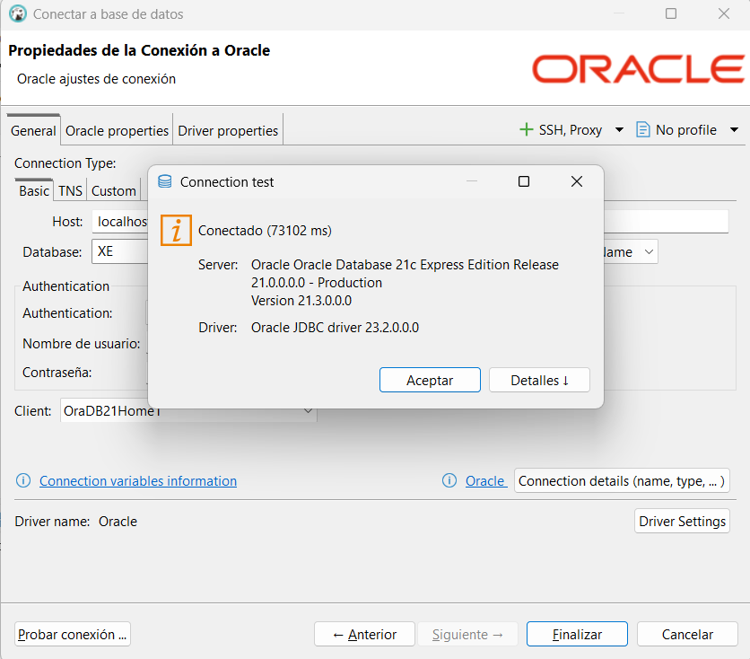

### 4.4 +++++++++++++++++++++++++++++++++++++++++++


## 5. Guía DBeaver

### 5.1 Instalación de DBeaver
1. Se busca la página oficial de DBeaver y se selcción la pestaña de Download:
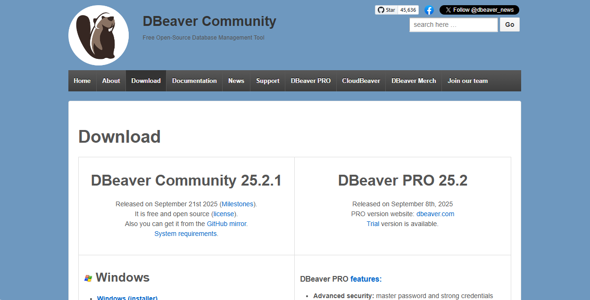
2. Se escoge la opción correpondiente al sistema operativo (en este caso es el de windows):
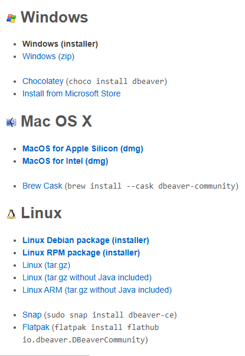
3. Una vez descargado se abre el instalador:
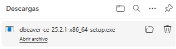
4. Se da click en siguiente:
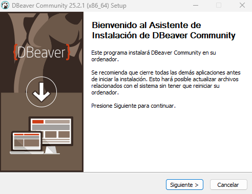
5. Se acepta el contrato de licencia:
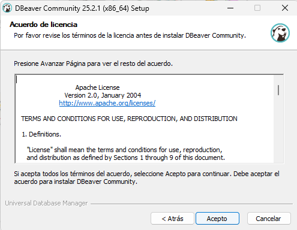
6. Se escoge si se desea instalar para todos los usuario o solo para el usuario de la sesión:
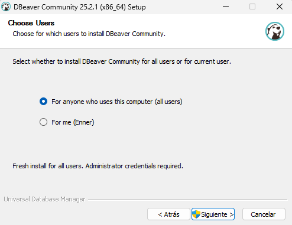
7. Se da nuevamente a siguiente ya que se reinició el programa como administrador para poder instalarse para todos lo usuario (si se escoge la opción de un único usuario, eso no sucede):
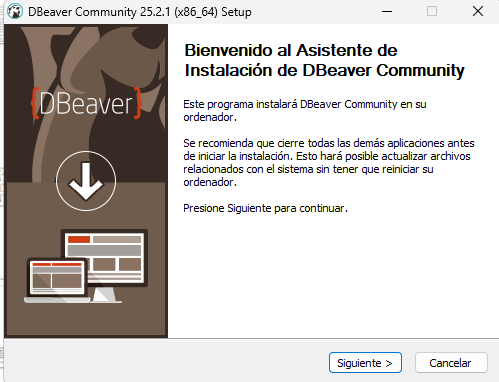
8. Nuevamente acepto lo términos y condiciones:
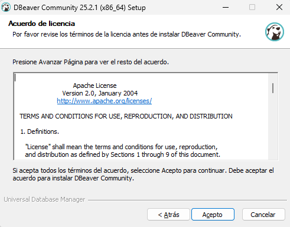
9.  Se agregan los componentes que sean necesario (para este caso no se necesita ninguno de estos, igualmente se pueden agregar posteriormente):
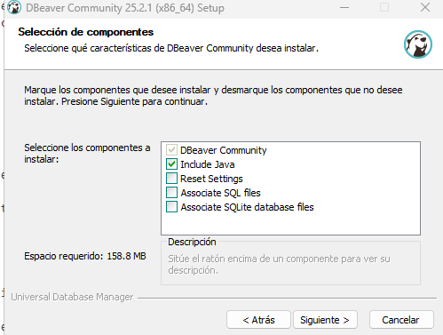
10. Se escoge la ruta:
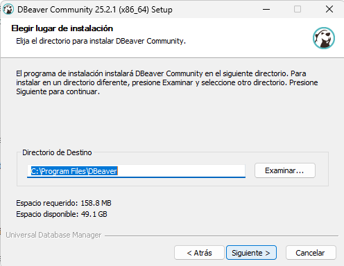
11. Se escoge la carpeta de Menú de Inicio:
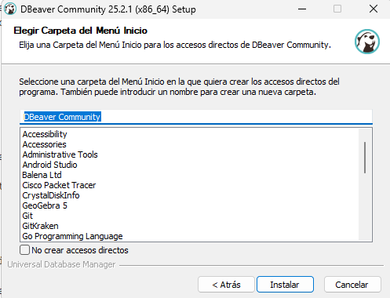
12. Una vez ya finalizado el proceso de instalación, si se desea se agrega un acceso directo:
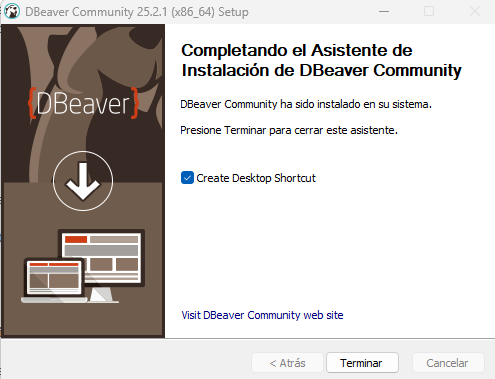

### 5.2 Uso de DBeaver

1. Cuando se abre DBeaver, se puede iniciar una nueva conexión.
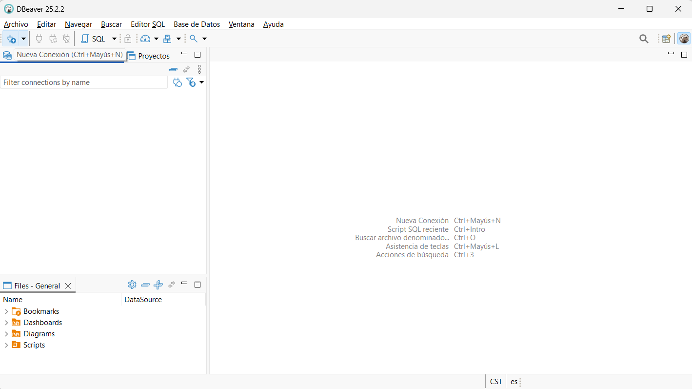
2. Se selecciona el tipo de base de datos que se quiere conectar.
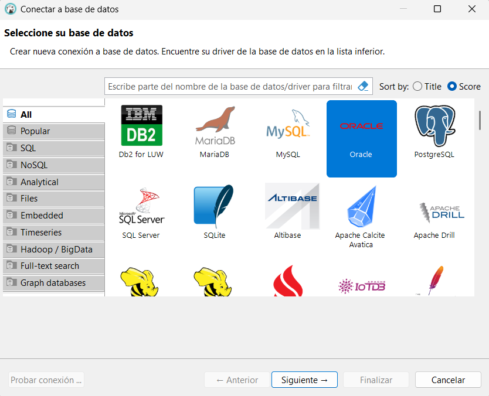
3. Una vez seleccionada, se rellena con la información necesaria.
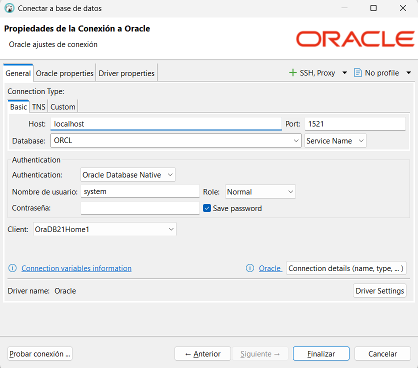
4. Una vez con los datos rellenados y pulsando el botón de probar conexión, se puede mostrar algo como lo siguiente que solicita que se instalen los drivers necesarios, por lo que se instala.
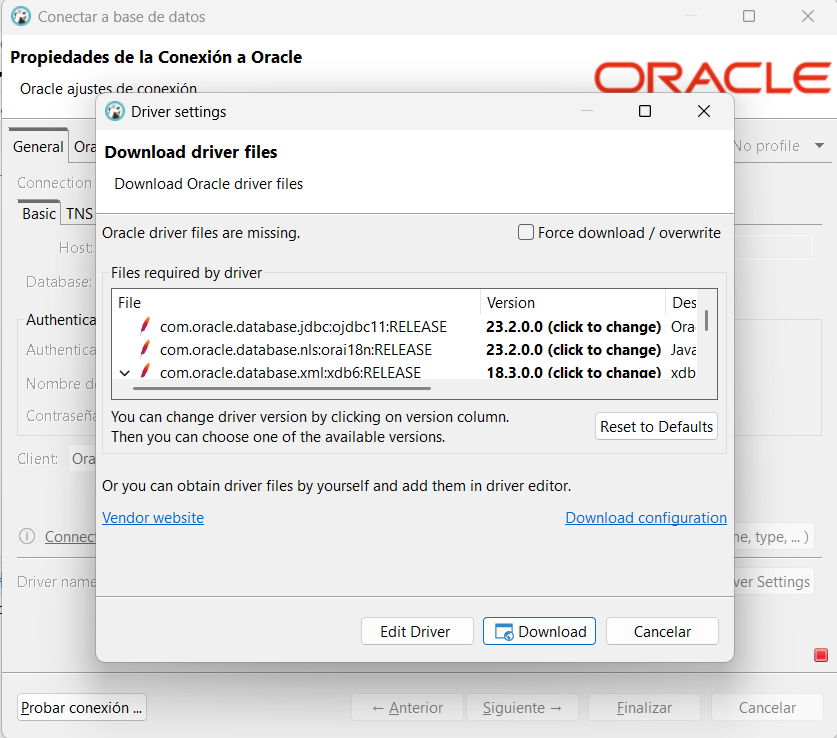
5. Una vez instalados, se muestra que la conexión se realizó correctamente.

6. Una vez que se haya logrado establecer conexión correctamente, se mostrará la base de datos al lado izquierdo.  
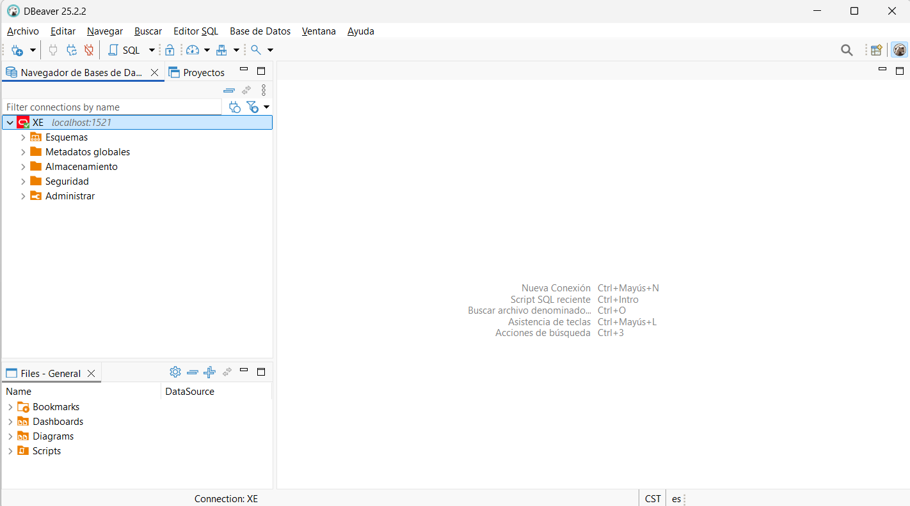


## 6. Backend y API REST
Con la base de datos funcional, se procedió a construir el API que sirve como intermediario para todas las operaciones de datos.

### 6.1. Configuración del Proyecto Node.js


**Inicialización:** Se inicializó un proyecto de Node.js en la carpeta `/api` con `npm init -y`.

**Instalación de Dependencias:** Se instalaron las siguientes librerías clave:

- **express:** Framework para la construcción del servidor y las rutas.
- **oracledb:** Driver oficial para la conexión con la base de datos Oracle.
- **cors:** Middleware para permitir peticiones desde diferentes orígenes.
- **dotenv:** Para manejar variables de entorno y no exponer credenciales en el código.
- **nodemon:** Para reiniciar automáticamente el servidor durante el desarrollo.

**Estructura Modular:** Se creó una carpeta `/api/routes` para alojar un archivo de rutas por cada tabla, manteniendo el archivo principal `index.js` limpio y organizado.

### 6.2. Servidor y Conexión a la Base de Datos
En `index.js`, se configuró un servidor Express básico y se estableció un pool de conexiones a la base de datos Oracle al iniciar la aplicación. Se utilizó el archivo `.env` para cargar de forma segura las credenciales (`DB_USER`, `DB_PASSWORD`, `DB_CONNECT_STRING`).

### 6.3. Desarrollo de Endpoints CRUD completos

Se implementaron endpoints para las operaciones CRUD (GET, POST, PUT, DELETE) para cada una de las 12 tablas.

#### 6.3.1. Patrón de Implementación

Para cada tabla, se siguió un patrón consistente:

**Archivo de Rutas Dedicado:** (e.g., `centro.routes.js`).

- **GET (Todos):** Una ruta `GET /` para obtener todos los registros, usualmente ordenados por su ID.
- **GET (Por ID):** Una ruta `GET /:id` para obtener un registro específico.
- **POST (Crear):** Una ruta `POST /` que recibe datos en el body, valida la presencia de campos requeridos y las llaves foráneas antes de ejecutar el INSERT.
- **PUT (Actualizar):** Una ruta `PUT /:id` para modificar un registro existente.
- **DELETE (Eliminar):** Una ruta `DELETE /:id` para borrar un registro.


#### 6.3.2. Lógica de Negocio y Validaciones

**Validación de Llaves Foráneas:** En las rutas POST y PUT de tablas dependientes (ej. MUNICIPIO), se implementaron funciones auxiliares para consultar a la base de datos y verificar que el "padre" (ej. DEPARTAMENTO) existe antes de permitir la operación.

**Manejo de Llaves Primarias Compuestas:** Para la tabla UBICACION, se diseñaron rutas específicas como `DELETE /escuela/:escuelaId/centro/:centroId` para poder identificar y operar sobre registros que tienen una clave compuesta.

**Manejo de Errores:** Se implementó un manejo de errores robusto para devolver códigos de estado HTTP apropiados (ej. 404 Not Found, 409 Conflict para IDs duplicados, 400 Bad Request para datos faltantes, y 500 Internal Server Error para fallos inesperados).

#### 6.3.3. Implementación de Eliminación en Cascada

Para mejorar la integridad y la lógica de negocio, se decidió modificar el comportamiento de eliminación por defecto.

**Modificación del DDL:** Se actualizó el archivo `db/ddl.sql`, añadiendo la cláusula `ON DELETE CASCADE` a todas las definiciones de llaves foráneas. Esto instruye a la base de datos para que, al eliminar un registro "padre", elimine automáticamente todos los registros "hijo" que dependen de él.

**Simplificación del API:** Con la lógica de eliminación ahora delegada a la base de datos, se refactorizó el código de todos los endpoints DELETE en el API. Se eliminó el bloque de código que manejaba el error de restricción de Oracle (`err.errorNum === 2292`), resultando en un código más limpio y directo.

Este cambio asegura que la lógica de negocio sea consistente y esté centralizada en la capa de datos, que es la más adecuada para manejar este tipo de reglas de integridad.


## 7. Uso de Endpoints


## 8. Capturas de evidencias


