# BD1B_2S2025_202302220

## Tabla de Contenidos
- [BD1B\_2S2025\_202302220](#bd1b_2s2025_202302220)
  - [Tabla de Contenidos](#tabla-de-contenidos)
  - [1. Objetivos](#1-objetivos)
    - [1.1 Objetivo General](#11-objetivo-general)
    - [1.2 Objetivos Específicos](#12-objetivos-específicos)
  - [2. Alcance del Proyecto](#2-alcance-del-proyecto)
    - [2.1 Inclusiones](#21-inclusiones)
    - [2.2 Exclusiones](#22-exclusiones)
  - [3. Descripción](#3-descripción)
    - [3.1 Tecnologías Principales](#31-tecnologías-principales)
    - [3.2 Características Clave](#32-características-clave)
  - [4. Pasos de Despliegue](#4-pasos-de-despliegue)
    - [Fase 0: Entendiendo la Arquitectura del Sistema](#fase-0-entendiendo-la-arquitectura-del-sistema)
      - [Contenedor db (Oracle Database)](#contenedor-db-oracle-database)
      - [Contenedor api (Node.js API)](#contenedor-api-nodejs-api)
      - [Docker Compose](#docker-compose)
      - [Diagrama Conceptual](#diagrama-conceptual)
    - [Fase 1: Preparación del Entorno (Pre-vuelo)](#fase-1-preparación-del-entorno-pre-vuelo)
      - [Requisitos Previos](#requisitos-previos)
    - [Fase 2: Configuración Crítica de Archivos](#fase-2-configuración-crítica-de-archivos)
      - [2.1. El Corazón de la Base de Datos: ddl.sql](#21-el-corazón-de-la-base-de-datos-ddlsql)
        - [Análisis del Script](#análisis-del-script)
      - [2.2. El Secreto de la API: El archivo .env](#22-el-secreto-de-la-api-el-archivo-env)
    - [Fase 3: El Despegue con Docker Compose](#fase-3-el-despegue-con-docker-compose)
      - [Análisis del Comando](#análisis-del-comando)
      - [¿Qué sucede detrás de escena?](#qué-sucede-detrás-de-escena)
    - [Fase 4: Verificación y Conexión Post-despliegue](#fase-4-verificación-y-conexión-post-despliegue)
      - [4.1. Verificación con Docker](#41-verificación-con-docker)
        - [Listar Contenedores en Ejecución](#listar-contenedores-en-ejecución)
        - [Revisar los Logs (Registros)](#revisar-los-logs-registros)
      - [4.2. Conexión Final con DBeaver](#42-conexión-final-con-dbeaver)
  - [5. Guía DBeaver](#5-guía-dbeaver)
    - [5.1 Instalación de DBeaver](#51-instalación-de-dbeaver)
    - [5.2 Uso de DBeaver](#52-uso-de-dbeaver)
  - [6. Backend y API REST](#6-backend-y-api-rest)
    - [6.1. Configuración del Proyecto Node.js](#61-configuración-del-proyecto-nodejs)
    - [6.2. Servidor y Conexión a la Base de Datos](#62-servidor-y-conexión-a-la-base-de-datos)
    - [6.3. Desarrollo de Endpoints CRUD completos](#63-desarrollo-de-endpoints-crud-completos)
      - [6.3.1. Patrón de Implementación](#631-patrón-de-implementación)
      - [6.3.2. Lógica de Negocio y Validaciones](#632-lógica-de-negocio-y-validaciones)
      - [6.3.3. Implementación de Eliminación en Cascada](#633-implementación-de-eliminación-en-cascada)
  - [7. Pruebas con DBeaver](#7-pruebas-con-dbeaver)
    - [7.1. Datos de prueba Insertados](#71-datos-de-prueba-insertados)
    - [7.2. Pruebas Directas con SQL](#72-pruebas-directas-con-sql)
      - [7.2.1. Consulta 1: Verificación Básica](#721-consulta-1-verificación-básica)
      - [7.2.2. Consulta 2: Verificación de Relaciones Simples (JOIN)](#722-consulta-2-verificación-de-relaciones-simples-join)
      - [7.2.3. Consulta 3: Siguiendo la Pista de un Registro](#723-consulta-3-siguiendo-la-pista-de-un-registro)
      - [7.2.4. Consulta 4: Detalle de un Examen](#724-consulta-4-detalle-de-un-examen)
  - [8. Uso de Endpoints](#8-uso-de-endpoints)
    - [8.1. Cómo usar ThunderClient](#81-cómo-usar-thunderclient)
    - [8.2. Plan de Pruebas de API](#82-plan-de-pruebas-de-api)
    - [8.2.1. Endpoints de CENTRO](#821-endpoints-de-centro)
      - [8.2.1.1. Prueba de GET](#8211-prueba-de-get)
        - [Resultado Esperado:](#resultado-esperado)
      - [8.2.1.2. Prueba de GET con ID](#8212-prueba-de-get-con-id)
        - [Resultado Esperado:](#resultado-esperado-1)
      - [8.2.1.3. Prueba de POST](#8213-prueba-de-post)
        - [Resultado Esperado:](#resultado-esperado-2)
      - [8.2.1.4. Prueba de PUT](#8214-prueba-de-put)
        - [Resultado Esperado:](#resultado-esperado-3)
      - [8.2.1.5. Prueba de DELETE](#8215-prueba-de-delete)
        - [Resultado Esperado:](#resultado-esperado-4)
    - [8.2.2. Endpoints de CORRELATIVO](#822-endpoints-de-correlativo)
      - [8.2.2.1. Prueba de GET](#8221-prueba-de-get)
        - [Resultado Esperado:](#resultado-esperado-5)
      - [8.2.2.2. Prueba de GET con ID](#8222-prueba-de-get-con-id)
        - [Resultado Esperado:](#resultado-esperado-6)
      - [8.2.2.3. Prueba de POST](#8223-prueba-de-post)
        - [Resultado Esperado:](#resultado-esperado-7)
      - [8.2.2.4. Prueba de PUT](#8224-prueba-de-put)
        - [Resultado Esperado:](#resultado-esperado-8)
      - [8.2.2.5. Prueba de DELETE](#8225-prueba-de-delete)
        - [Resultado Esperado:](#resultado-esperado-9)
    - [8.2.3. Endpoints de DEPARTAMENTOS](#823-endpoints-de-departamentos)
      - [8.2.3.1. Prueba de GET](#8231-prueba-de-get)
        - [Resultado Esperado:](#resultado-esperado-10)
      - [8.2.3.2. Prueba de GET con ID](#8232-prueba-de-get-con-id)
        - [Resultado Esperado:](#resultado-esperado-11)
      - [8.2.3.3. Prueba de POST](#8233-prueba-de-post)
        - [Resultado Esperado:](#resultado-esperado-12)
      - [8.2.3.4. Prueba de PUT](#8234-prueba-de-put)
        - [Resultado Esperado:](#resultado-esperado-13)
      - [8.2.3.5. Prueba de DELETE](#8235-prueba-de-delete)
        - [Resultado Esperado:](#resultado-esperado-14)
    - [8.2.4. Endpoints de ESCUELA](#824-endpoints-de-escuela)
      - [8.2.4.1. Prueba de GET](#8241-prueba-de-get)
        - [Resultado Esperado:](#resultado-esperado-15)
      - [8.2.4.2. Prueba de GET con ID](#8242-prueba-de-get-con-id)
        - [Resultado Esperado:](#resultado-esperado-16)
      - [8.2.4.3. Prueba de POST](#8243-prueba-de-post)
        - [Resultado Esperado:](#resultado-esperado-17)
      - [8.2.4.4. Prueba de PUT](#8244-prueba-de-put)
        - [Resultado Esperado:](#resultado-esperado-18)
      - [8.2.4.5. Prueba de DELETE](#8245-prueba-de-delete)
        - [Resultado Esperado:](#resultado-esperado-19)
    - [8.2.5. Endpoints de PREG](#825-endpoints-de-preg)
      - [8.2.5.1. Prueba de GET](#8251-prueba-de-get)
        - [Resultado Esperado:](#resultado-esperado-20)
      - [8.2.5.2. Prueba de GET con ID](#8252-prueba-de-get-con-id)
        - [Resultado Esperado:](#resultado-esperado-21)
      - [8.2.5.3. Prueba de POST](#8253-prueba-de-post)
        - [Resultado Esperado:](#resultado-esperado-22)
      - [8.2.5.4. Prueba de PUT](#8254-prueba-de-put)
        - [Resultado Esperado:](#resultado-esperado-23)
      - [8.2.5.5. Prueba de DELETE](#8255-prueba-de-delete)
        - [Resultado Esperado:](#resultado-esperado-24)
    - [8.2.6. Endpoints de PREG\_PRACT](#826-endpoints-de-preg_pract)
      - [8.2.6.1. Prueba de GET](#8261-prueba-de-get)
        - [Resultado Esperado:](#resultado-esperado-25)
      - [8.2.6.2. Prueba de GET con ID](#8262-prueba-de-get-con-id)
        - [Resultado Esperado:](#resultado-esperado-26)
      - [8.2.6.3. Prueba de POST](#8263-prueba-de-post)
        - [Resultado Esperado:](#resultado-esperado-27)
      - [8.2.6.4. Prueba de PUT](#8264-prueba-de-put)
        - [Resultado Esperado:](#resultado-esperado-28)
      - [8.2.6.5. Prueba de DELETE](#8265-prueba-de-delete)
        - [Resultado Esperado:](#resultado-esperado-29)
    - [8.2.7. Endpoints de MUNICIPIO](#827-endpoints-de-municipio)
      - [8.2.7.1. Prueba de GET](#8271-prueba-de-get)
        - [Resultado Esperado:](#resultado-esperado-30)
      - [8.2.7.2. Prueba de GET con ID](#8272-prueba-de-get-con-id)
        - [Resultado Esperado:](#resultado-esperado-31)
      - [8.2.7.3. Prueba de POST](#8273-prueba-de-post)
        - [Resultado Esperado:](#resultado-esperado-32)
      - [8.2.7.4. Prueba de PUT](#8274-prueba-de-put)
        - [Resultado Esperado:](#resultado-esperado-33)
      - [8.2.7.5. Prueba de DELETE](#8275-prueba-de-delete)
        - [Resultado Esperado:](#resultado-esperado-34)
        - [Resultado Esperado:](#resultado-esperado-35)
    - [8.2.8. Endpoints de UBICACION](#828-endpoints-de-ubicacion)
      - [8.2.8.1. Prueba de GET](#8281-prueba-de-get)
        - [Resultado Esperado:](#resultado-esperado-36)
      - [8.2.8.2. Prueba de GET con ID](#8282-prueba-de-get-con-id)
        - [Resultado Esperado:](#resultado-esperado-37)
      - [8.2.8.3. Prueba de POST](#8283-prueba-de-post)
        - [Resultado Esperado:](#resultado-esperado-38)
      - [8.2.8.4. Prueba de PUT](#8284-prueba-de-put)
        - [Resultado Esperado:](#resultado-esperado-39)
      - [8.2.8.5. Prueba de DELETE](#8285-prueba-de-delete)
        - [Resultado Esperado:](#resultado-esperado-40)
    - [8.2.9. Endpoints de REGISTRO](#829-endpoints-de-registro)
      - [8.2.9.1. Prueba de GET](#8291-prueba-de-get)
        - [Resultado Esperado:](#resultado-esperado-41)
      - [8.2.9.2. Prueba de GET con ID](#8292-prueba-de-get-con-id)
        - [Resultado Esperado:](#resultado-esperado-42)
      - [8.2.9.3. Prueba de POST](#8293-prueba-de-post)
        - [Resultado Esperado:](#resultado-esperado-43)
      - [8.2.9.4. Prueba de PUT](#8294-prueba-de-put)
        - [Resultado Esperado:](#resultado-esperado-44)
      - [8.2.9.5. Prueba de DELETE](#8295-prueba-de-delete)
        - [Resultado Esperado:](#resultado-esperado-45)
    - [8.2.10. Endpoints de EXAMEN](#8210-endpoints-de-examen)
      - [8.2.10.1. Prueba de GET](#82101-prueba-de-get)
        - [Resultado Esperado:](#resultado-esperado-46)
      - [8.2.10.2. Prueba de GET con ID](#82102-prueba-de-get-con-id)
        - [Resultado Esperado:](#resultado-esperado-47)
      - [8.2.10.3. Prueba de POST](#82103-prueba-de-post)
        - [Resultado Esperado:](#resultado-esperado-48)
      - [8.2.10.4. Prueba de PUT](#82104-prueba-de-put)
        - [Resultado Esperado:](#resultado-esperado-49)
      - [8.2.10.5. Prueba de DELETE](#82105-prueba-de-delete)
        - [Resultado Esperado:](#resultado-esperado-50)
    - [8.2.11. Endpoints de RES\_PRACT\_USU](#8211-endpoints-de-res_pract_usu)
      - [8.2.11.1. Prueba de GET](#82111-prueba-de-get)
        - [Resultado Esperado:](#resultado-esperado-51)
      - [8.2.11.2. Prueba de GET con ID](#82112-prueba-de-get-con-id)
        - [Resultado Esperado:](#resultado-esperado-52)
      - [8.2.11.3. Prueba de POST](#82113-prueba-de-post)
        - [Resultado Esperado:](#resultado-esperado-53)
      - [8.2.11.4. Prueba de PUT](#82114-prueba-de-put)
        - [Resultado Esperado:](#resultado-esperado-54)
      - [8.2.11.5. Prueba de DELETE](#82115-prueba-de-delete)
        - [Resultado Esperado:](#resultado-esperado-55)
    - [8.2.12. Endpoints de RES\_USU](#8212-endpoints-de-res_usu)
      - [8.2.12.1. Prueba de GET](#82121-prueba-de-get)
        - [Resultado Esperado:](#resultado-esperado-56)
      - [8.2.12.2. Prueba de GET con ID](#82122-prueba-de-get-con-id)
        - [Resultado Esperado:](#resultado-esperado-57)
      - [8.2.12.3. Prueba de POST](#82123-prueba-de-post)
        - [Resultado Esperado:](#resultado-esperado-58)
      - [8.2.12.4. Prueba de PUT](#82124-prueba-de-put)
        - [Resultado Esperado:](#resultado-esperado-59)
      - [8.2.12.5. Prueba de DELETE](#82125-prueba-de-delete)
        - [Resultado Esperado:](#resultado-esperado-60)
  - [9. Capturas de evidencias](#9-capturas-de-evidencias)


## 1. Objetivos

### 1.1 Objetivo General
 Diseñar e implementar un backend portable, versionado y reproducible para la base de datos de los Centros de Evaluación, empleando Docker para la infraestructura, DBeaver para la administración y una API REST desarrollada en Node.js/Express para exponer operaciones CRUD y consultas predefinidas.

### 1.2 Objetivos Específicos
* **Contenerizar** la base de datos del sistema utilizando Docker y Docker Compose para garantizar un entorno de desarrollo y despliegue consistente.
* **Configurar** y validar la conexión y administración de la base de datos desde el cliente DBeaver.
* **Desarrollar** una API REST utilizando Node.js y el framework Express que sirva como interfaz para interactuar con la base de datos.
* **Implementar** los endpoints necesarios para realizar operaciones CRUD (Crear, Leer, Actualizar, Eliminar) en todas las tablas del modelo relacional.
* **Definir** y exponer mediante endpoints específicos tres consultas SQL estandarizadas y de utilidad para el sistema.
* **Documentar** y validar el funcionamiento de todos los endpoints de la API REST a través de una colección de pruebas en Postman.
---

## 2. Alcance del Proyecto

### 2.1 Inclusiones
* El desarrollo se centra en la creación de un **backend dockerizado** que incluye la base de datos y la API REST.
* La configuración de la base de datos se realiza a través de un archivo ```docker-compose.yml``` y se inicializa con un script DDL proporcionado.
* Implementación de una **API REST** con endpoints para todas las operaciones CRUD y tres consultas SQL específicas.
* Creación de una guía en el archivo ```README.md``` para el despliegue del proyecto y el uso de los endpoints.
* Validación y documentación de toda la API mediante una **colección de Postman** exportada.
* El código fuente completo se gestionará y entregará a través de un **repositorio en GitHub**.

### 2.2 Exclusiones
* El desarrollo de una interfaz de usuario o **frontend** para consumir la API.
* El despliegue del sistema en un entorno de producción o en servicios en la nube.
* La implementación de mecanismos de **autenticación o autorización** para los endpoints de la API.
* El diseño del modelo relacional de la base de datos.
* Configuración de pipelines de Integración Continua y Despliegue Continuo.


## 3. Descripción

Este proyecto consiste en el desarrollo e implementación de un **backend** para el sistema de gestión de **Centros de Evaluación**. El sistema está diseñado para dar respuesta a la necesidad de administrar y consultar evaluaciones teóricas y prácticas de manera eficiente y centralizada.

La solución se centra en la creación de una arquitectura de servicios portable y reproducible. Para ello, se ha contenerizado la base de datos relacional utilizando **Docker** y **Docker Compose**, garantizando un entorno de desarrollo y despliegue consistente que se puede levantar con un solo comando.

Sobre esta base de datos, se ha desarrollado una **API REST** con **Node.js** y **Express**, que actúa como intermediario para todas las operaciones de datos. La API expone un conjunto completo de endpoints para gestionar la información del sistema, siguiendo las mejores prácticas de diseño de APIs.

El resultado final es un backend robusto, portable y fácil de probar, sentando las bases para futuras expansiones del sistema, como la integración de una interfaz de usuario (frontend).

### 3.1 Tecnologías Principales
* **Contenerización:** Docker, Docker Compose
* **API Backend:** Node.js, Express.js
* **Base de Datos:** Base de datos relacional (Oracle Database) gestionada en un contenedor.
* **Cliente de BD:** DBeaver para administración y consulta directa.
* **Pruebas de API:** Postman

### 3.2 Características Clave

* **Infraestructura como Código:** Uso de docker-compose.yml para definir y ejecutar todo el entorno de la aplicación.
* **API RESTful:** Endpoints para operaciones CRUD (Crear, Leer, Actualizar, Borrar) en todas las tablas del sistema.
* **Consultas Personalizadas:** Exposición de 3 consultas SQL predefinidas a través de endpoints específicos para obtener datos complejos o reportes.
* **Validación y Documentación:** Colección completa en Postman para probar, validar y documentar cada endpoint de la API.

## 4. Pasos de Despliegue

### Fase 0: Entendiendo la Arquitectura del Sistema

Antes de escribir cualquier comando, es vital comprender cómo interactúan los componentes. Nuestro sistema se basa en una arquitectura de microservicios contenerizada:

#### Contenedor db (Oracle Database)

- **Imagen**: `gvenzl/oracle-xe:latest`. Una imagen popular y optimizada de Oracle Express Edition.
- **Función**: Alberga la base de datos. Es el cerebro persistente de nuestra aplicación. Al iniciar, ejecuta automáticamente cualquier script `.sql` que encuentre en la carpeta montada, lo que nos permite inicializar el esquema y crear nuestro usuario `API_USER` de forma automática.

#### Contenedor api (Node.js API)

- **Imagen**: Construida a partir de nuestro propio Dockerfile.
- **Función**: Expone los endpoints REST para interactuar con la base de datos. Contiene toda la lógica de negocio. Se conecta al contenedor `db` usando la red interna que Docker crea automáticamente.

#### Docker Compose

- **Archivo**: `docker-compose.yml`.
- **Función**: Es el director de orquesta. Define los servicios (`db`, `api`), cómo se construyen, cómo se conectan entre sí y qué volúmenes y puertos utilizan. Nos permite levantar y destruir todo el entorno con un solo comando.

#### Diagrama Conceptual

```
[Tu Máquina] <--> [DBeaver] <--> [Contenedor 'db' (Oracle)] <--> [Contenedor 'api' (Node.js)] <--> [Postman/Cliente]
```

### Fase 1: Preparación del Entorno (Pre-vuelo)

Asegúrate de tener las herramientas necesarias antes de comenzar.

#### Requisitos Previos

- **Docker Desktop**: Es la forma más sencilla de obtener tanto Docker Engine como Docker Compose en Windows y macOS. Asegúrate de que el motor de Docker esté en ejecución.
- **Cliente de Base de Datos**: Se recomienda DBeaver por su versatilidad, pero cualquier cliente compatible con Oracle (como Oracle SQL Developer) funcionará.
- **Código Fuente**: Clona o descarga el repositorio del proyecto en tu máquina local.

### Fase 2: Configuración Crítica de Archivos

Este es el paso más importante. Una configuración incorrecta aquí es la causa del 90% de los problemas de despliegue.

#### 2.1. El Corazón de la Base de Datos: ddl.sql

Este archivo no solo crea las tablas, sino que prepara el entorno de seguridad dentro de Oracle.

- **Ubicación**: `/db/ddl.sql`
- **Acción Requerida**: Define una contraseña segura para el usuario de la aplicación.

**¡IMPORTANTE!** Dentro del archivo `ddl.sql`, localiza esta sección al inicio:

```sql
-- ### 0. CREACIÓN DEL USUARIO Y ASIGNACIÓN DE PERMISOS
CREATE USER API_USER IDENTIFIED BY tu_password_seguro;
```

Sustituye `tu_password_seguro` por una contraseña real (en este caso, realmente se usó la contraseña `tu_password_seguro`). Esta es la clave que la API usará para autenticarse.

##### Análisis del Script

- `CREATE USER API_USER...`: Crea una cuenta dedicada exclusivamente para la aplicación, evitando usar usuarios con privilegios de sistema como `SYS`.
- `GRANT CONNECT, RESOURCE, DBA...`: Otorga los permisos. `CONNECT` para iniciar sesión, `RESOURCE` para crear tablas/vistas y `DBA` (para desarrollo) para evitar cualquier problema de permisos.
- `ALTER SESSION SET CURRENT_SCHEMA = API_USER;`: Esta es la línea clave. Asegura que todas las sentencias `CREATE TABLE` posteriores se ejecuten en el esquema de `API_USER`, haciendo que las tablas sean "suyas".

#### 2.2. El Secreto de la API: El archivo .env

Este archivo contiene los secretos que la API necesita para funcionar, como las credenciales de la base de datos. Nunca debe ser subido a un repositorio público.

- **Acción Requerida**: Crea un nuevo archivo de texto.
- **Ubicación**: `/api/.env` (dentro de la carpeta api).
- **Contenido**: Copia y pega el siguiente bloque, y asegúrate de que la contraseña coincida con la que pusiste en `ddl.sql`.

```env
# ==========================================
# VARIABLES DE ENTORNO PARA EL API NODE.JS
# ==========================================

# Puerto en el que se expondrá el servidor de la API
PORT=3000

# --- Credenciales para la conexión a Oracle ---

# Usuario de la Base de Datos. Debe ser el mismo que en ddl.sql
DB_USER=API_USER

# Contraseña para el usuario de la BD. ¡Debe coincidir con la de ddl.sql!
DB_PASSWORD=tu_password_seguro

# Cadena de conexión a la base de datos Oracle
# - 'db': Es el nombre del servicio de la base de datos en docker-compose.yml. Docker lo resuelve a la IP interna del contenedor.
# - '1521': El puerto estándar de Oracle.
# - 'XE': El "Service Name" por defecto para Oracle Express Edition.
DB_CONNECT_STRING=db:1521/XE
```

### Fase 3: El Despegue con Docker Compose

Ahora que todo está configurado, vamos a dar vida a nuestros servicios.

1. Abre una terminal (PowerShell, CMD, Terminal de Mac/Linux) en la carpeta raíz de tu proyecto, donde se encuentra el archivo `docker-compose.yml`.

2. Ejecuta el comando de construcción y despliegue:

```bash
docker-compose up --build -d
```

#### Análisis del Comando

- `docker-compose up`: Lee el archivo `docker-compose.yml` e inicia los servicios que define.
- `--build`: Le dice a Docker Compose que primero construya la imagen de la API desde su Dockerfile antes de iniciarla. Es crucial si has hecho cambios en el código de la API.
- `-d` (detached): Ejecuta los contenedores en segundo plano, liberando tu terminal.

#### ¿Qué sucede detrás de escena?

1. Docker descarga la imagen de Oracle (`gvenzl/oracle-xe`) si no la tienes.
2. Docker construye la imagen de tu API siguiendo los pasos del Dockerfile (instala npm, copia el código, etc.).
3. Se crea una red virtual para que los contenedores puedan comunicarse por su nombre de servicio (por eso `db` funciona en la cadena de conexión).
4. El contenedor `db` se inicia. El healthcheck en `docker-compose.yml` espera a que Oracle esté completamente listo antes de permitir que la API se inicie.
5. Una vez Oracle está "saludable", el contenedor `api` se inicia, lee el archivo `.env` y establece la conexión con la base de datos.

### Fase 4: Verificación y Conexión Post-despliegue

¿Cómo sabemos si todo ha funcionado?

#### 4.1. Verificación con Docker

##### Listar Contenedores en Ejecución

```bash
docker-compose ps
```

Deberías ver una tabla con los servicios `db` y `api`, ambos con el estado `Up` o `running`.

##### Revisar los Logs (Registros)

**Para la Base de Datos:**

```bash
docker-compose logs db
```

Busca mensajes que indiquen que la base de datos está lista (`DATABASE IS READY TO USE!`) y que los scripts de inicialización se ejecutaron.

**Para la API:**

```bash
docker-compose logs api
```

Deberías ver los mensajes de tu `index.js`: `Pool de conexiones a Oracle creado exitosamente.` y `Servidor API corriendo en http://localhost:3000`.

#### 4.2. Conexión Final con DBeaver

Esta es la prueba de fuego que confirma que tu `ddl.sql` funcionó.

1. Abre DBeaver y haz clic en **Nueva Conexión**.
2. Selecciona **Oracle**.
3. Rellena los campos de la pestaña "Principal":
   - **Host**: `localhost`
   - **Puerto**: `1521`
   - **Conexión**: Asegúrate de seleccionar **Service Name** (y no SID).
   - **Service Name**: `XE`
4. **Autenticación**:
   - **Usuario**: `API_USER`
   - **Contraseña**: La contraseña que estableciste en los archivos de configuración (`tu_password_seguro`).
5. Haz clic en **Probar Conexión...**. DBeaver podría solicitar descargar los drivers JDBC de Oracle. Permítelo.
6. Si la prueba es exitosa, haz clic en **Finalizar**.

**Resultado Esperado**: Al conectarte y expandir el árbol de la base de datos, deberías ver inmediatamente todas tus tablas (`CENTRO`, `ESCUELA`, `REGISTRO`, etc.) bajo el esquema de `API_USER`. Si las ves, ¡has triunfado! Tu entorno está 100% operativo.

## 5. Guía DBeaver

### 5.1 Instalación de DBeaver
1. Se busca la página oficial de DBeaver y se selcción la pestaña de Download:

2. Se escoge la opción correpondiente al sistema operativo (en este caso es el de windows):

3. Una vez descargado se abre el instalador:

4. Se da click en siguiente:

5. Se acepta el contrato de licencia:

6. Se escoge si se desea instalar para todos los usuario o solo para el usuario de la sesión:

7. Se da nuevamente a siguiente ya que se reinició el programa como administrador para poder instalarse para todos lo usuario (si se escoge la opción de un único usuario, eso no sucede):

8. Nuevamente acepto lo términos y condiciones:

9.  Se agregan los componentes que sean necesario (para este caso no se necesita ninguno de estos, igualmente se pueden agregar posteriormente):

10. Se escoge la ruta:

11. Se escoge la carpeta de Menú de Inicio:

12. Una vez ya finalizado el proceso de instalación, si se desea se agrega un acceso directo:


### 5.2 Uso de DBeaver

1. Cuando se abre DBeaver, se puede iniciar una nueva conexión.

2. Se selecciona el tipo de base de datos que se quiere conectar.

3. Una vez seleccionada, se rellena con la información necesaria.

4. Una vez con los datos rellenados y pulsando el botón de probar conexión, se puede mostrar algo como lo siguiente que solicita que se instalen los drivers necesarios, por lo que se instala.

5. Una vez instalados, se muestra que la conexión se realizó correctamente.

6. Una vez que se haya logrado establecer conexión correctamente, se mostrará la base de datos al lado izquierdo.  


## 6. Backend y API REST
Con la base de datos funcional, se procedió a construir el API que sirve como intermediario para todas las operaciones de datos.

### 6.1. Configuración del Proyecto Node.js


**Inicialización:** Se inicializó un proyecto de Node.js en la carpeta `/api` con `npm init -y`.

**Instalación de Dependencias:** Se instalaron las siguientes librerías clave:

- **express:** Framework para la construcción del servidor y las rutas.
- **oracledb:** Driver oficial para la conexión con la base de datos Oracle.
- **cors:** Middleware para permitir peticiones desde diferentes orígenes.
- **dotenv:** Para manejar variables de entorno y no exponer credenciales en el código.
- **nodemon:** Para reiniciar automáticamente el servidor durante el desarrollo.

**Estructura Modular:** Se creó una carpeta `/api/routes` para alojar un archivo de rutas por cada tabla, manteniendo el archivo principal `index.js` limpio y organizado.

### 6.2. Servidor y Conexión a la Base de Datos
En `index.js`, se configuró un servidor Express básico y se estableció un pool de conexiones a la base de datos Oracle al iniciar la aplicación. Se utilizó el archivo `.env` para cargar de forma segura las credenciales (`DB_USER`, `DB_PASSWORD`, `DB_CONNECT_STRING`).

### 6.3. Desarrollo de Endpoints CRUD completos

Se implementaron endpoints para las operaciones CRUD (GET, POST, PUT, DELETE) para cada una de las 12 tablas.

#### 6.3.1. Patrón de Implementación

Para cada tabla, se siguió un patrón consistente:

**Archivo de Rutas Dedicado:** (e.g., `centro.routes.js`).

- **GET (Todos):** Una ruta `GET /` para obtener todos los registros, usualmente ordenados por su ID.
- **GET (Por ID):** Una ruta `GET /:id` para obtener un registro específico.
- **POST (Crear):** Una ruta `POST /` que recibe datos en el body, valida la presencia de campos requeridos y las llaves foráneas antes de ejecutar el INSERT.
- **PUT (Actualizar):** Una ruta `PUT /:id` para modificar un registro existente.
- **DELETE (Eliminar):** Una ruta `DELETE /:id` para borrar un registro.


#### 6.3.2. Lógica de Negocio y Validaciones

**Validación de Llaves Foráneas:** En las rutas POST y PUT de tablas dependientes (ej. MUNICIPIO), se implementaron funciones auxiliares para consultar a la base de datos y verificar que el "padre" (ej. DEPARTAMENTO) existe antes de permitir la operación.

**Manejo de Llaves Primarias Compuestas:** Para la tabla UBICACION, se diseñaron rutas específicas como `DELETE /escuela/:escuelaId/centro/:centroId` para poder identificar y operar sobre registros que tienen una clave compuesta.

**Manejo de Errores:** Se implementó un manejo de errores robusto para devolver códigos de estado HTTP apropiados (ej. 404 Not Found, 409 Conflict para IDs duplicados, 400 Bad Request para datos faltantes, y 500 Internal Server Error para fallos inesperados).

#### 6.3.3. Implementación de Eliminación en Cascada

Para mejorar la integridad y la lógica de negocio, se decidió modificar el comportamiento de eliminación por defecto.

**Modificación del DDL:** Se actualizó el archivo `db/ddl.sql`, añadiendo la cláusula `ON DELETE CASCADE` a todas las definiciones de llaves foráneas. Esto instruye a la base de datos para que, al eliminar un registro "padre", elimine automáticamente todos los registros "hijo" que dependen de él.

**Simplificación del API:** Con la lógica de eliminación ahora delegada a la base de datos, se refactorizó el código de todos los endpoints DELETE en el API. Se eliminó el bloque de código que manejaba el error de restricción de Oracle (`err.errorNum === 2292`), resultando en un código más limpio y directo.

Este cambio asegura que la lógica de negocio sea consistente y esté centralizada en la capa de datos, que es la más adecuada para manejar este tipo de reglas de integridad.


## 7. Pruebas con DBeaver

Aqui se realizaron una serie de consultas para verificar la integridad y conexión de los datos, primero directamente en la base de datos con DBeaver y luego a través de los endpoints correspondientes de la API (que se realizaría en el siguiente punto). 

### 7.1. Datos de prueba Insertados

```sql
- ### 1. Inserción en tablas de catálogo (sin dependencias) ###
INSERT INTO DEPARTAMENTO(ID_DEPARTAMENTO, NOMBRE, CODIGO) VALUES (1, 'Guatemala', 1);
INSERT INTO DEPARTAMENTO(ID_DEPARTAMENTO, NOMBRE, CODIGO) VALUES (2, 'Escuintla', 5);
INSERT INTO DEPARTAMENTO(ID_DEPARTAMENTO, NOMBRE, CODIGO) VALUES (3, 'Sacatepéquez', 3);

INSERT INTO CENTRO(ID_CENTRO, NOMBRE) VALUES (10, 'Centro de Evaluación Zona 18');
INSERT INTO CENTRO(ID_CENTRO, NOMBRE) VALUES (20, 'Maycom Escuintla');
INSERT INTO CENTRO(ID_CENTRO, NOMBRE) VALUES (30, 'Centro de Evaluación Antigua');

INSERT INTO ESCUELA(ID_ESCUELA, NOMBRE, DIRECCION, ACUERDO) VALUES (100, 'Escuela de Manejo "El Maestro"', 'Calle Falsa 123, Ciudad', 'AC-2023-001');
INSERT INTO ESCUELA(ID_ESCUELA, NOMBRE, DIRECCION, ACUERDO) VALUES (200, 'Academia "Rápido y Seguro"', 'Avenida Siempre Viva 742, Escuintla', 'AC-2022-085');
INSERT INTO ESCUELA(ID_ESCUELA, NOMBRE, DIRECCION, ACUERDO) VALUES (300, 'Academia de Pilotos San Cristóbal', '4ta Calle 1-20, Antigua', 'AC-2024-030');

INSERT INTO PREG(ID_PREG, PREG_TEXTO, RES, RES1, RES2, RES3, RES4) VALUES (1, '¿Qué significa una línea continua en el pavimento?', 'No rebasar', 'No rebasar', 'Rebasar con precaución', 'Zona escolar', 'Curva peligrosa');
INSERT INTO PREG(ID_PREG, PREG_TEXTO, RES, RES1, RES2, RES3, RES4) VALUES (2, '¿Cuál es la velocidad máxima en una zona urbana?', '50 km/h', '80 km/h', '50 km/h', '60 km/h', 'No hay límite');
INSERT INTO PREG(ID_PREG, PREG_TEXTO, RES, RES1, RES2, RES3, RES4) VALUES (3, 'La luz roja del semáforo indica:', 'Alto total', 'Reducir velocidad', 'Alto total', 'Pasar si no vienen carros', 'Ceder el paso');

INSERT INTO PREG_PRACT(ID_PREG_PRACT, PREG_TEXTO, PUNTEO) VALUES (101, 'Realizar estacionamiento en paralelo.', 25);
INSERT INTO PREG_PRACT(ID_PREG_PRACT, PREG_TEXTO, PUNTEO) VALUES (102, 'Zigzag entre conos sin derribar ninguno.', 30);
INSERT INTO PREG_PRACT(ID_PREG_PRACT, PREG_TEXTO, PUNTEO) VALUES (103, 'Arranque en pendiente.', 15);

INSERT INTO CORRELATIVO(ID_CORRELATIVO, FECHA, NO_EXAMEN) VALUES (1, TO_DATE('2025-10-15', 'YYYY-MM-DD'), 1);
INSERT INTO CORRELATIVO(ID_CORRELATIVO, FECHA, NO_EXAMEN) VALUES (2, TO_DATE('2025-10-16', 'YYYY-MM-DD'), 1);

-- ### 2. Inserción en tablas con dependencias ###
INSERT INTO MUNICIPIO(ID_MUNICIPIO, NOMBRE, CODIGO, DEPARTAMENTO_ID_DEPARTAMENTO) VALUES (101, 'Guatemala', 1, 1);
INSERT INTO MUNICIPIO(ID_MUNICIPIO, NOMBRE, CODIGO, DEPARTAMENTO_ID_DEPARTAMENTO) VALUES (108, 'Villa Nueva', 8, 1);
INSERT INTO MUNICIPIO(ID_MUNICIPIO, NOMBRE, CODIGO, DEPARTAMENTO_ID_DEPARTAMENTO) VALUES (501, 'Escuintla', 1, 2);
INSERT INTO MUNICIPIO(ID_MUNICIPIO, NOMBRE, CODIGO, DEPARTAMENTO_ID_DEPARTAMENTO) VALUES (301, 'Antigua Guatemala', 1, 3);

INSERT INTO UBICACION(ESCUELA_ID_ESCUELA, CENTRO_ID_CENTRO) VALUES (100, 10);
INSERT INTO UBICACION(ESCUELA_ID_ESCUELA, CENTRO_ID_CENTRO) VALUES (200, 10); -- Escuela 200 puede examinar en Centro 10
INSERT INTO UBICACION(ESCUELA_ID_ESCUELA, CENTRO_ID_CENTRO) VALUES (200, 20); -- y también en Centro 20
INSERT INTO UBICACION(ESCUELA_ID_ESCUELA, CENTRO_ID_CENTRO) VALUES (300, 30);

-- ### 3. Inserción de registros de personas y sus exámenes ###
-- Persona 1
INSERT INTO REGISTRO(ID_REGISTRO, FECHA, TIPO_TRAMITE, TIPO_LICENCIA, NOMBRE_COMPLETO, GENERO, MUNICIPIO_ID_MUNICIPIO, UBICACION_ESCUELA_ID, UBICACION_CENTRO_ID) VALUES (1, TO_DATE('2025-10-15', 'YYYY-MM-DD'), 'Primera Licencia', 'C', 'Juan Carlos Pérez Gómez', 'M', 108, 100, 10);
INSERT INTO EXAMEN(ID_EXAMEN, REGISTRO_ID_REGISTRO, CORRELATIVO_ID_CORRELATIVO) VALUES (1001, 1, 1);

-- Persona 2
INSERT INTO REGISTRO(ID_REGISTRO, FECHA, TIPO_TRAMITE, TIPO_LICENCIA, NOMBRE_COMPLETO, GENERO, MUNICIPIO_ID_MUNICIPIO, UBICACION_ESCUELA_ID, UBICACION_CENTRO_ID) VALUES (2, TO_DATE('2025-10-16', 'YYYY-MM-DD'), 'Renovación', 'B', 'Ana María López Solorzano', 'F', 301, 300, 30);
INSERT INTO EXAMEN(ID_EXAMEN, REGISTRO_ID_REGISTRO, CORRELATIVO_ID_CORRELATIVO) VALUES (1002, 2, 2);

-- ### 4. Inserción de respuestas para cada examen ###
-- Respuestas para el examen de Juan Pérez (ID 1001)
INSERT INTO RES_USU(ID_RES_USU, RES, PREG_ID_PREG, EXAMEN_ID_EXAMEN) VALUES (1, 'No rebasar', 1, 1001); -- Correcta
INSERT INTO RES_USU(ID_RES_USU, RES, PREG_ID_PREG, EXAMEN_ID_EXAMEN) VALUES (2, '80 km/h', 2, 1001); -- Incorrecta
INSERT INTO RES_PRACT_USU(ID_RES_PRACT, NOTA, PREG_PRACT_ID_PREG_PRACT, EXAMEN_ID_EXAMEN) VALUES (1, 20, 101, 1001);
INSERT INTO RES_PRACT_USU(ID_RES_PRACT, NOTA, PREG_PRACT_ID_PREG_PRACT, EXAMEN_ID_EXAMEN) VALUES (2, 25, 102, 1001);

-- Respuestas para el examen de Ana López (ID 1002)
INSERT INTO RES_USU(ID_RES_USU, RES, PREG_ID_PREG, EXAMEN_ID_EXAMEN) VALUES (3, '50 km/h', 2, 1002); -- Correcta
INSERT INTO RES_USU(ID_RES_USU, RES, PREG_ID_PREG, EXAMEN_ID_EXAMEN) VALUES (4, 'Alto total', 3, 1002); -- Correcta
INSERT INTO RES_PRACT_USU(ID_RES_PRACT, NOTA, PREG_PRACT_ID_PREG_PRACT, EXAMEN_ID_EXAMEN) VALUES (3, 15, 103, 1002);
```

### 7.2. Pruebas Directas con SQL

#### 7.2.1. Consulta 1: Verificación Básica

**Objetivo:** ¿Están los datos de las tablas principales cargados?

**Acción:** Revisa el contenido completo de una tabla de catálogo simple.

```sql
-- ¿Están todos los departamentos que inserté?
SELECT * FROM DEPARTAMENTO ORDER BY ID_DEPARTAMENTO;

-- ¿Están todas las escuelas?
SELECT * FROM ESCUELA ORDER BY ID_ESCUELA;
```

Los resultados fueron los siguientes respectivamente:

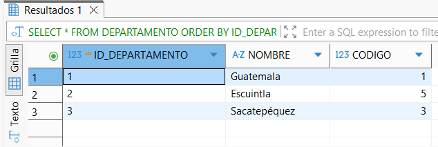

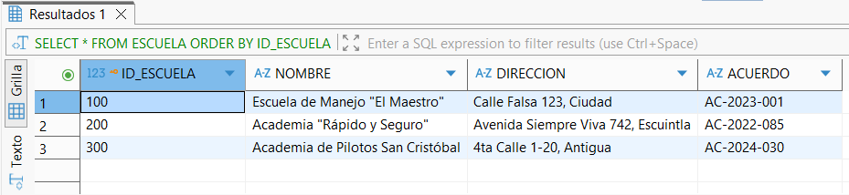

#### 7.2.2. Consulta 2: Verificación de Relaciones Simples (JOIN)

**Objetivo:** ¿Se conecta correctamente un municipio con su departamento?

**Acción:** Unimos MUNICIPIO y DEPARTAMENTO para mostrar información combinada.

```sql
-- Muestra cada municipio junto al nombre de su departamento
SELECT
    m.ID_MUNICIPIO,
    m.NOMBRE AS NOMBRE_MUNICIPIO,
    d.NOMBRE AS NOMBRE_DEPARTAMENTO
FROM
    MUNICIPIO m
JOIN
    DEPARTAMENTO d ON m.DEPARTAMENTO_ID_DEPARTAMENTO = d.ID_DEPARTAMENTO
ORDER BY
    d.NOMBRE, m.NOMBRE;
```

El resultado fue el siguiente:
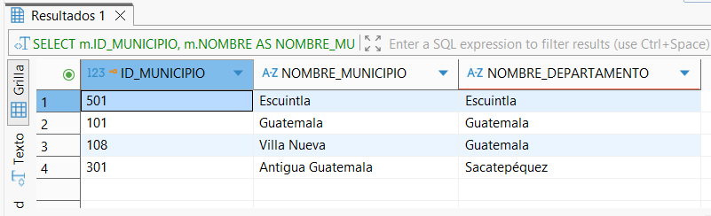

#### 7.2.3. Consulta 3: Siguiendo la Pista de un Registro

**Objetivo:** Ver la "historia completa" de una persona registrada.

**Acción:** Unimos múltiples tablas para obtener una vista 360° de un registro específico (en este caso, el de ID_REGISTRO = 1).

```sql
-- Muestra todos los detalles de la persona con ID 1, incluyendo su ubicación y datos geográficos.
SELECT
    r.ID_REGISTRO,
    r.NOMBRE_COMPLETO,
    r.TIPO_LICENCIA,
    r.FECHA AS FECHA_REGISTRO,
    esc.NOMBRE AS NOMBRE_ESCUELA,
    cen.NOMBRE AS NOMBRE_CENTRO,
    mun.NOMBRE AS MUNICIPIO_RESIDENCIA,
    dep.NOMBRE AS DEPARTAMENTO_RESIDENCIA
FROM
    REGISTRO r
JOIN
    UBICACION u ON r.UBICACION_ESCUELA_ID = u.ESCUELA_ID_ESCUELA AND r.UBICACION_CENTRO_ID = u.CENTRO_ID_CENTRO
JOIN
    ESCUELA esc ON u.ESCUELA_ID_ESCUELA = esc.ID_ESCUELA
JOIN
    CENTRO cen ON u.CENTRO_ID_CENTRO = cen.ID_CENTRO
JOIN
    MUNICIPIO mun ON r.MUNICIPIO_ID_MUNICIPIO = mun.ID_MUNICIPIO
JOIN
    DEPARTAMENTO dep ON mun.DEPARTAMENTO_ID_DEPARTAMENTO = dep.ID_DEPARTAMENTO
WHERE
    r.ID_REGISTRO = 1;
```

El resultado fue el siguiente:

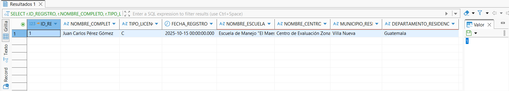

#### 7.2.4. Consulta 4: Detalle de un Examen

**Objetivo:** Ver todas las respuestas teóricas y prácticas de un examen específico.

**Acción:** Unimos el examen con sus respuestas teóricas y prácticas.

```sql
-- Muestra el desglose completo del examen con ID 1001
-- Respuestas teóricas
SELECT
    ex.ID_EXAMEN,
    reg.NOMBRE_COMPLETO,
    p.PREG_TEXTO,
    ru.RES AS RESPUESTA_USUARIO,
    p.RES AS RESPUESTA_CORRECTA
FROM
    RES_USU ru
JOIN
    EXAMEN ex ON ru.EXAMEN_ID_EXAMEN = ex.ID_EXAMEN
JOIN
    PREG p ON ru.PREG_ID_PREG = p.ID_PREG
JOIN
    REGISTRO reg ON ex.REGISTRO_ID_REGISTRO = reg.ID_REGISTRO
WHERE
    ex.ID_EXAMEN = 1001;

-- Respuestas prácticas
SELECT
    ex.ID_EXAMEN,
    reg.NOMBRE_COMPLETO,
    pp.PREG_TEXTO,
    rpu.NOTA,
    pp.PUNTEO AS PUNTEO_MAXIMO
FROM
    RES_PRACT_USU rpu
JOIN
    EXAMEN ex ON rpu.EXAMEN_ID_EXAMEN = ex.ID_EXAMEN
JOIN
    PREG_PRACT pp ON rpu.PREG_PRACT_ID_PREG_PRACT = pp.ID_PREG_PRACT
JOIN
    REGISTRO reg ON ex.REGISTRO_ID_REGISTRO = reg.ID_REGISTRO
WHERE
    ex.ID_EXAMEN = 1001;
```
Los resultados fueron los siguientes, respectivamente:

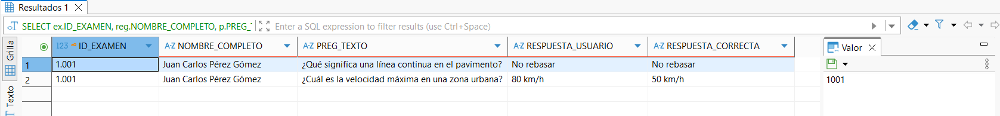

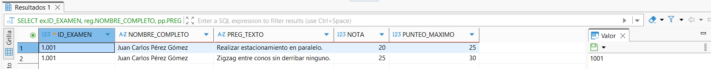

## 8. Uso de Endpoints

### 8.1. Cómo usar ThunderClient

Para probar los endpoints, se usará una extensión de VScode llamada 'Thunder Client'.

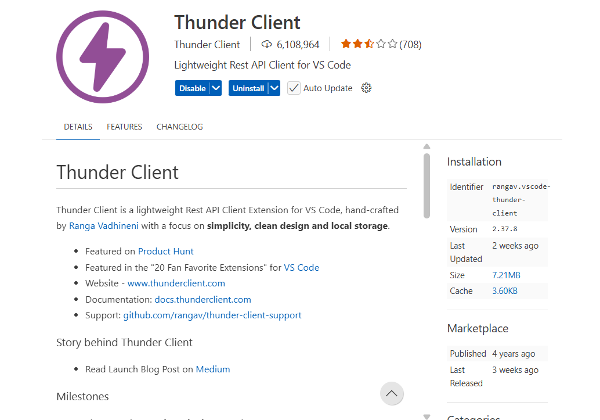

Ahora bien, para comenzar las pruebas con esta, se tiene que acceder al panel que se crea al instalar esta extensión y pulsar "New Request".

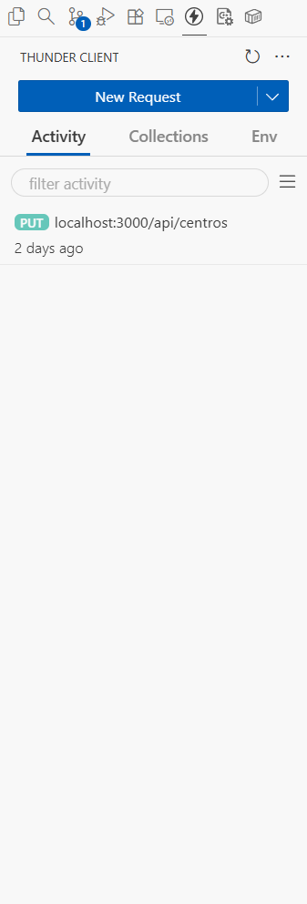

Una vez que se abre, se muestra la siguiente inteerfa que permitirá que se puedan realizar las pruebas al api.

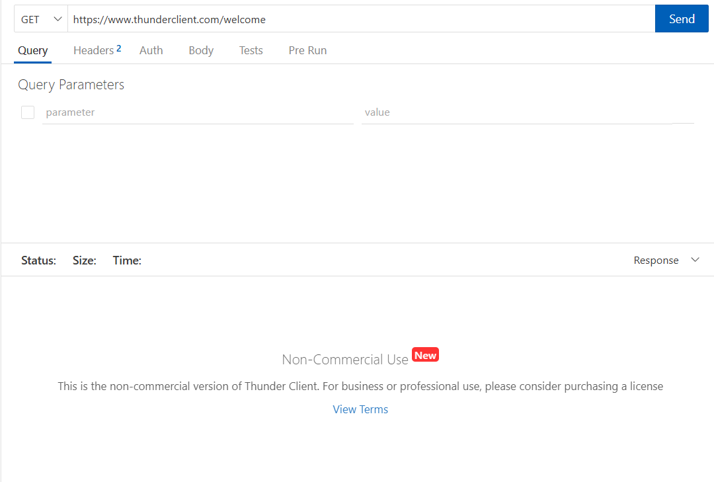

En la sección de donde dice 'GET' se puede seleccionar el tipo de petición que se realizará y la dirección a la cual se le realizará.

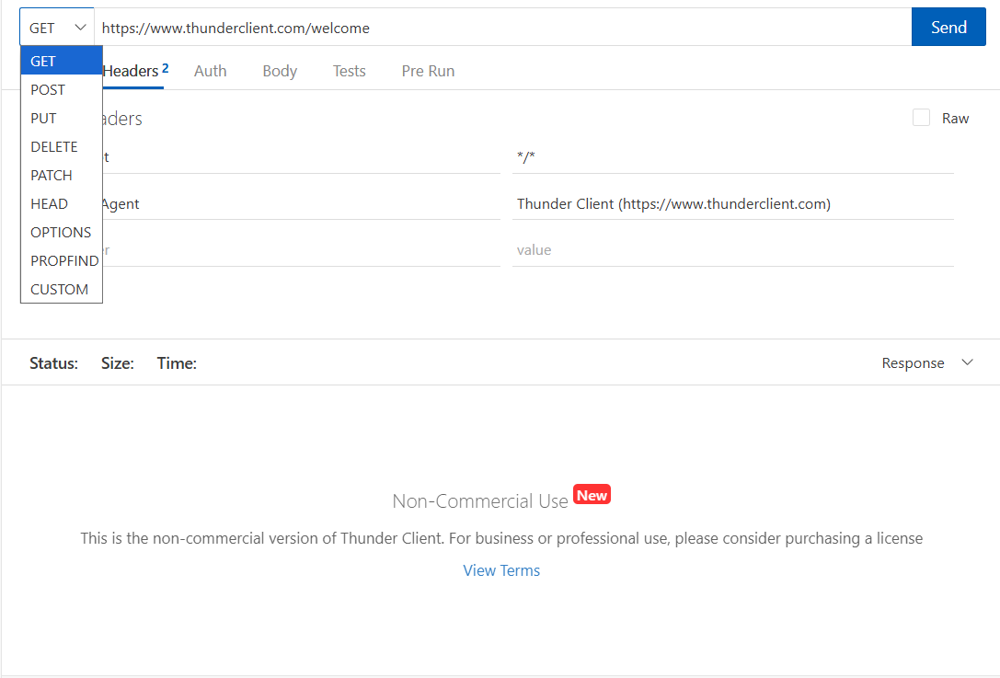

Además, en la sección 'Header' se pueden modificar los headers que se enviarán.

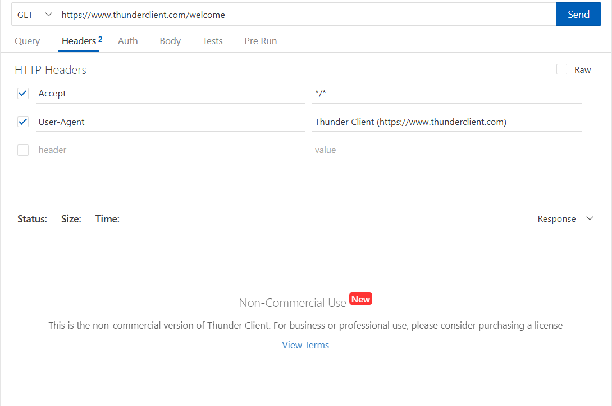

Y en la sección 'body' se coloca el contenido de lo que se enviará, dependiendo de la manera en la que esto se trabaje, puede estar en esos distitnso formatos, sin embargo, en este caso se usará todo en formato json.

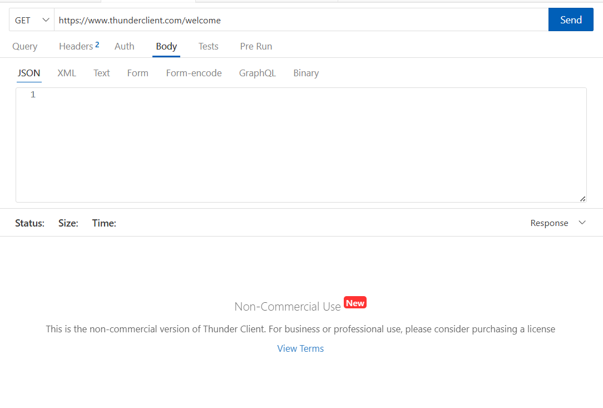

### 8.2. Plan de Pruebas de API

Para ralizar todas estas pruebas, se usarán los mismos datos que se usaron para probar la conexión con DBeaver en el punto 7.

Ahora bien, estos datos se restaurarán para cada enpoint que se fuere probando.

### 8.2.1. Endpoints de CENTRO

#### 8.2.1.1. Prueba de GET 

##### Resultado Esperado:
#### 8.2.1.2. Prueba de GET con ID

##### Resultado Esperado:
#### 8.2.1.3. Prueba de POST

##### Resultado Esperado:
#### 8.2.1.4. Prueba de PUT

##### Resultado Esperado:
#### 8.2.1.5. Prueba de DELETE

##### Resultado Esperado:


### 8.2.2. Endpoints de CORRELATIVO

#### 8.2.2.1. Prueba de GET 

##### Resultado Esperado:
#### 8.2.2.2. Prueba de GET con ID

##### Resultado Esperado:
#### 8.2.2.3. Prueba de POST

##### Resultado Esperado:
#### 8.2.2.4. Prueba de PUT

##### Resultado Esperado:
#### 8.2.2.5. Prueba de DELETE

##### Resultado Esperado:

### 8.2.3. Endpoints de DEPARTAMENTOS

#### 8.2.3.1. Prueba de GET 

**Endpoint:** /api/departamentos

**URL Completa:** http://localhost:3000/api/departamentos

**Acción:** Envía la petición.

##### Resultado Esperado:
```JSON
Código de Estado: 200 OK
```

**Cuerpo de la Respuesta (Body):** Deberías recibir un array JSON con los 3 departamentos que insertaste.

```json
[
    {
        "ID_DEPARTAMENTO": 1,
        "NOMBRE": "Guatemala",
        "CODIGO": 1
    },
    {
        "ID_DEPARTAMENTO": 2,
        "NOMBRE": "Escuintla",
        "CODIGO": 5
    },
    {
        "ID_DEPARTAMENTO": 3,
        "NOMBRE": "Sacatepéquez",
        "CODIGO": 3
    }
]
```

Efectivamente se retornó lo esperado:

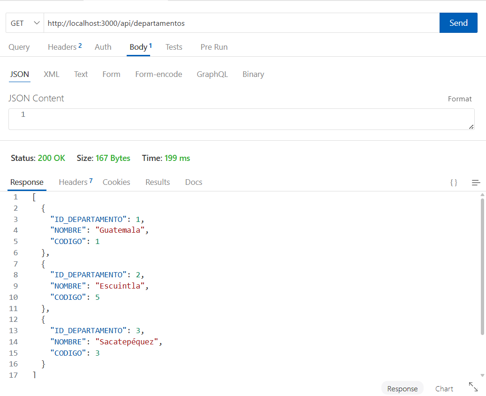

#### 8.2.3.2. Prueba de GET con ID

**Endpoint:** /api/departamentos/:id

**URL Completa:** http://localhost:3000/api/departamentos/2

**Acción:** Envía la petición para obtener el departamento con ID = 2.

##### Resultado Esperado:
```json
Código de Estado: 200 OK
```

**Cuerpo de la Respuesta (Body):** Deberías recibir un único objeto JSON.
```json
{
    "ID_DEPARTAMENTO": 2,
    "NOMBRE": "Escuintla",
    "CODIGO": 5
}
```

Y efectivamente retornó lo esperado:

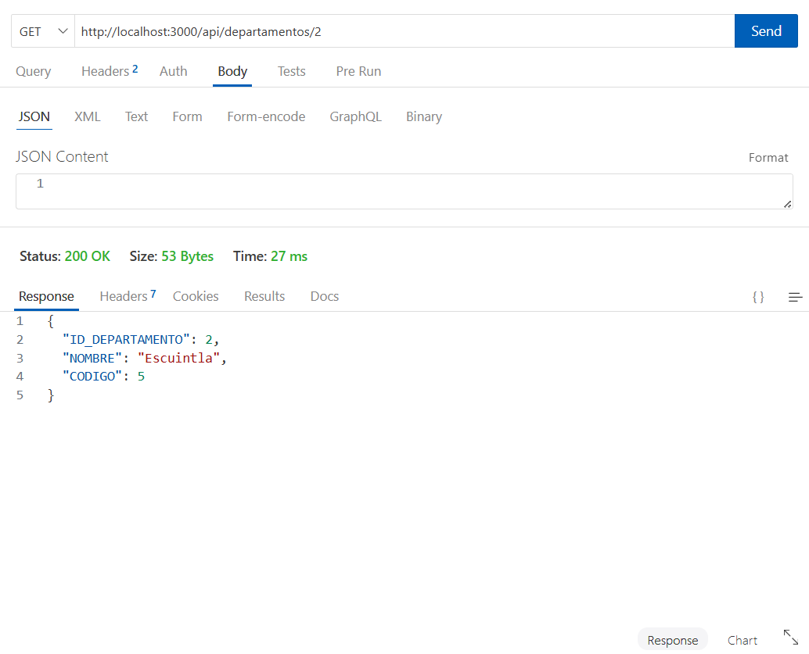


#### 8.2.3.3. Prueba de POST

**Endpoint:** /api/departamentos

**URL Completa:** http://localhost:3000/api/departamentos

**Acción:**

Ir a la pestaña Body, deleccionar el tipo raw y el formato JSON y pegar el siguiente objeto JSON:

```json 
{
    "id_departamento": 4,
    "nombre": "El Progreso",
    "codigo": 2
}
```
 Y enviar la petición.

##### Resultado Esperado:

**Código de Estado:**
```json
201 Created
```

**Cuerpo de la Respuesta (Body):**

```json
{
    "message": "Departamento creado exitosamente",
    "data": {
        "id_departamento": 4,
        "nombre": "El Progreso",
        "codigo": 2
    }
}
```

Y efectivamente retornó el resultado esperado:


#### 8.2.3.4. Prueba de PUT

**Endpoint:** /api/departamentos/:id

**URL Completa:** http://localhost:3000/api/departamentos/4

**Acción:**

Ir a la pestaña Body, selecciona el tipo raw y el formato JSON y pegar el siguiente objeto JSON:
```json
{
    "nombre": "El Progreso (editado)",
    "codigo": 2
}

```

##### Resultado Esperado:

**Código de Estado:**
```json
201 OK
```

**Cuerpo de la Respuesta (Body):**
```json
{
    "message": "Departamento actualizado exitosamente."
}
```

Y efectivamente retornó lo esperado:

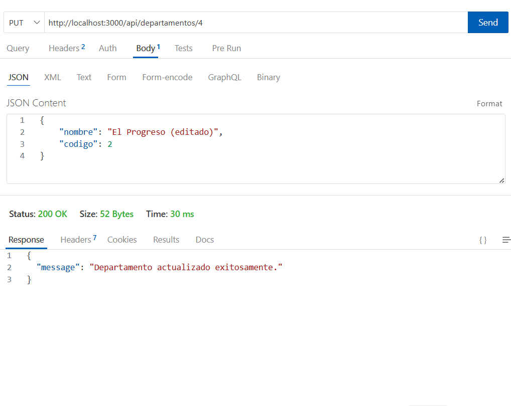

#### 8.2.3.5. Prueba de DELETE

**Endpoint:** /api/departamentos/:id

**URL Completa:** http://localhost:3000/api/departamentos/4

**Acción:** Enviar la petición.

##### Resultado Esperado:

**Código de Estado:**
```json
200 OK
```

**Cuerpo de la Respuesta (Body):**

```json
{
    "message": "Departamento eliminado exitosamente."
}
```

Efectivamente retornó el resultado esperado:

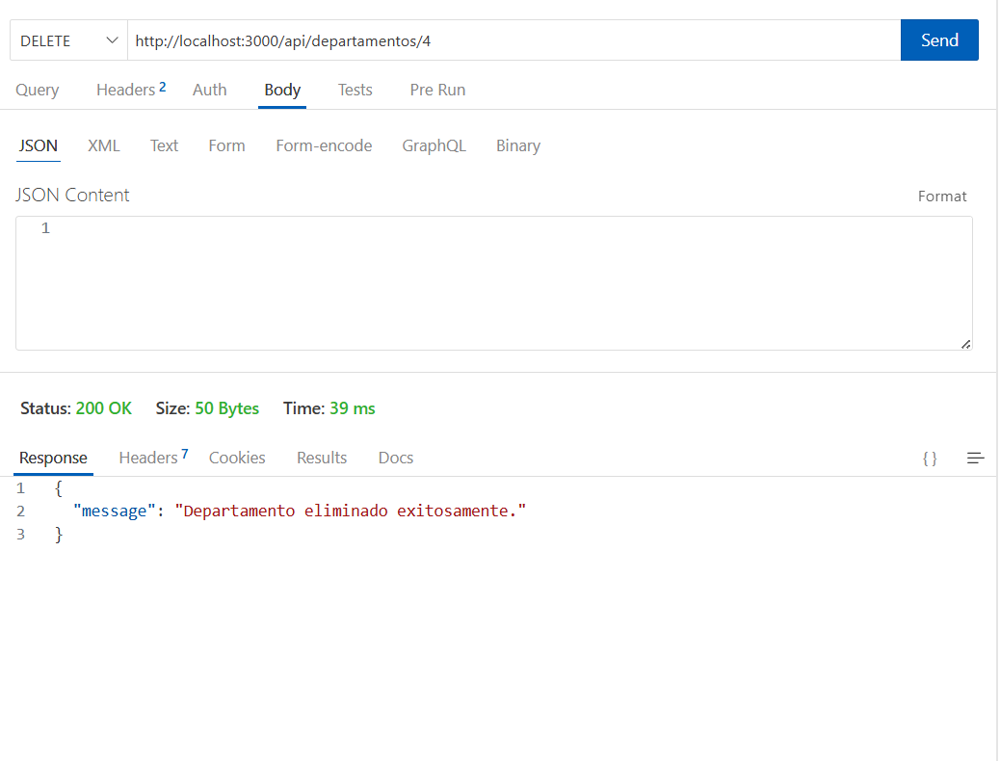

### 8.2.4. Endpoints de ESCUELA

#### 8.2.4.1. Prueba de GET 

**Endpoint:** /api/escuelas

**URL Completa:** http://localhost:3000/api/escuelas

**Acción:** Envía la petición.

##### Resultado Esperado:

Código de Estado:
```json
200 OK
```

**Cuerpo de la Respuesta (Body):** Un array JSON con los 5 municipios iniciales.

```json
[
    {
        "ID_ESCUELA": 100,
        "NOMBRE": "Escuela de Manejo \"El Maestro\"",
        "DIRECCION": "Calle Falsa 123",
        "ACUERDO": "AC-2023-001"
    },
    {
        "ID_ESCUELA": 200,
        "NOMBRE": "Academia \"Rápido y Seguro\"",
        "DIRECCION": "Avenida Siempre Viva 742",
        "ACUERDO": "AC-2022-085"
    },
    {
        "ID_ESCUELA": 300,
        "NOMBRE": "Academia de Pilotos San Cristóbal",
        "DIRECCION": "4ta Calle 1-20, Antigua",
        "ACUERDO": "AC-2024-030"
    }
]
```

Y efectivamente, dio el resultado correcto:

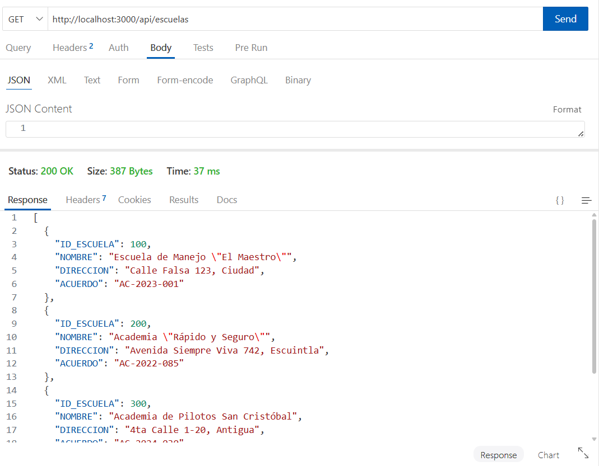

#### 8.2.4.2. Prueba de GET con ID

**Endpoint:** /api/escuelas/:id

**URL Completa:** http://localhost:3000/api/escuelas/200

**Acción:** Envía la petición para obtener la escuela con ID = 200.

##### Resultado Esperado:

Código de Estado:
```json
200 OK
```

Cuerpo de la Respuesta (Body): Un único objeto JSON para Villa Nueva.

```json
{
    "ID_ESCUELA": 200,
    "NOMBRE": "Academia \"Rápido y Seguro\"",
    "DIRECCION": "Avenida Siempre Viva 742",
    "ACUERDO": "AC-2022-085"
}
```

Y efectivamente dio el resultado esperado:

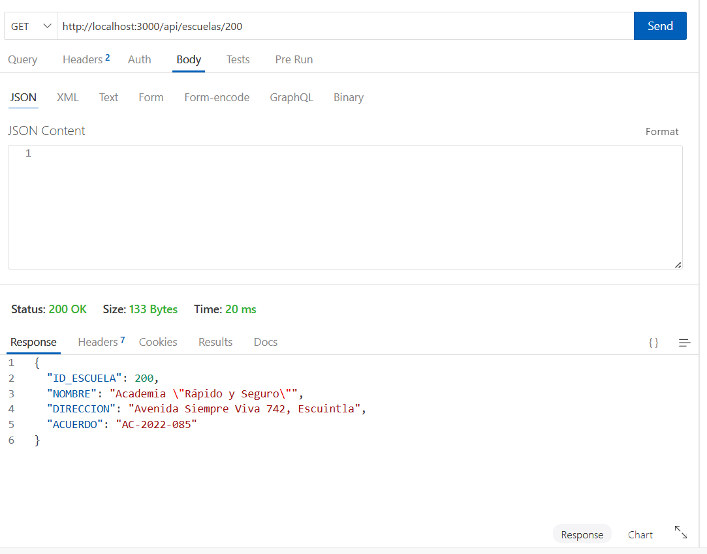

#### 8.2.4.3. Prueba de POST

**Endpoint:** /api/escuelas

**URL Completa:** http://localhost:3000/api/escuelas

**Acción:**
Ir a la pestaña Body, seleccionar raw y el formato JSON, y pegar el siguiente objeto:

```json
{
    "id_escula": 400,
    "nombre": "Escuela Vial de Guatemala",
    "direccion": "Zona 10, Edificio Test",
    "acuerdo": "AC-2025-001"
}
```

Y enviar la petición.

##### Resultado Esperado:

**Código de Estado:**
```json
201 Created
```

**Cuerpo de la Respuesta (Body):** 

```json
{
    "message": "Escuela creada exitosamente",
    "data": {
        "id_escuela": 400,
        "nombre": "Escuela Vial de Guatemala",
        "direccion": "Zona 10, Edificio Test",
        "acuerdo": "AC-2025-001"
    }
}
```

Efectivamente dio el resultado esperado:

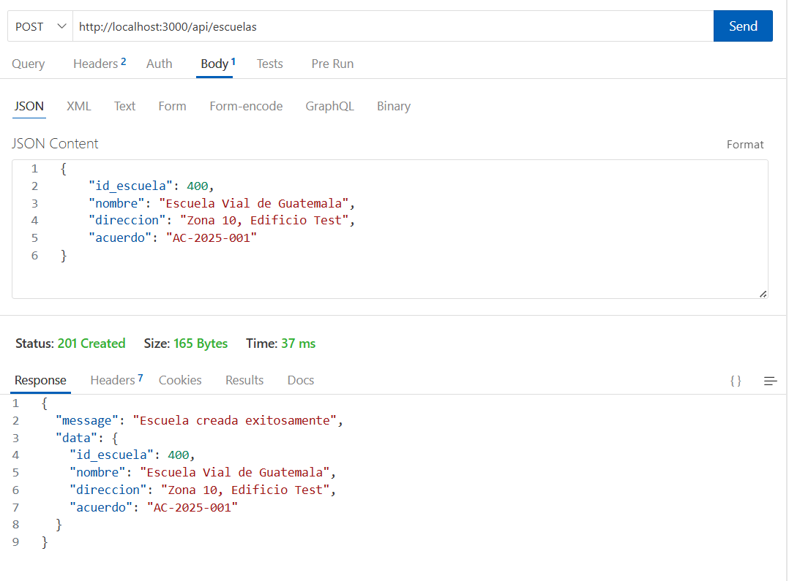

#### 8.2.4.4. Prueba de PUT

**Endpoint:** /api/escuelas/:id

**URL Completa:** http://localhost:3000/api/escuelas/400

**Acción:**

Ir a la pestaña Body, seleccionar raw y JSON, y pegar el siguiente objeto:

```json
{
    "nombre": "Escuela Vial de Guatemala (Sede Central)",
    "direccion": "Zona 10, Edificio Test, Nivel 2",
    "acuerdo": "AC-2025-001-MOD"
}
```

Y enviar la petición.

##### Resultado Esperado:

Código de Estado:

```json
200 OK
```


**Cuerpo de la Respuesta (Body):**
```json
{
    "message": "Escuela actualizada exitosamente."
}
```

Y se mostró correctamente:
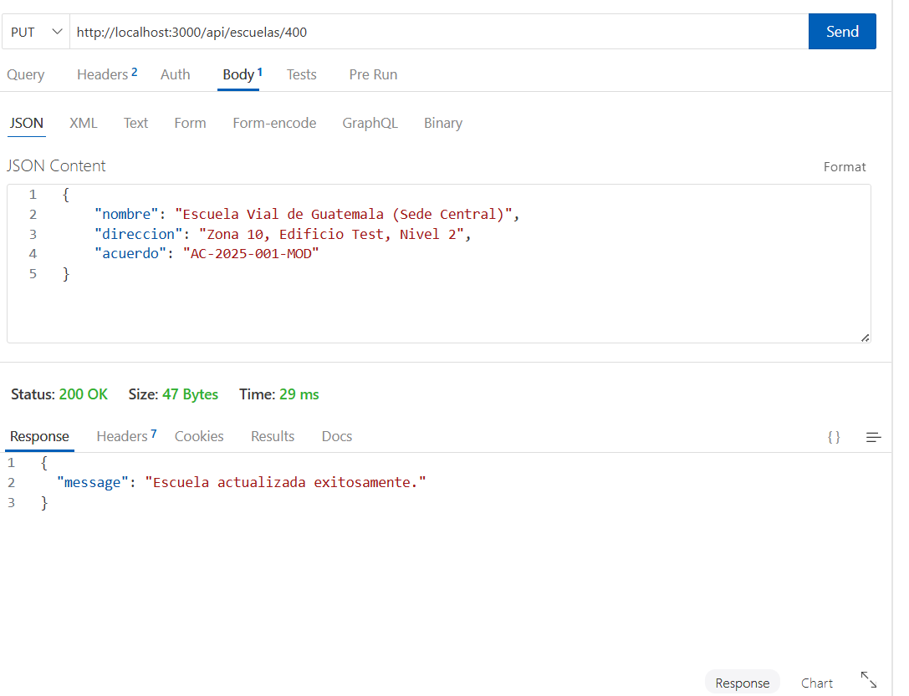

#### 8.2.4.5. Prueba de DELETE

**Endpoint:** /api/escuelas/:id

**URL Completa:** http://localhost:3000/api/escuelas/400

**Acción:** Enviar la petición.


##### Resultado Esperado:

**Código de Estado:**
```json
200 OK
```


**Cuerpo de la Respuesta (Body):**
```json
{
    "message": "Escuela eliminada exitosamente."
}
```

Y se obtuvo el resultado correctamente:

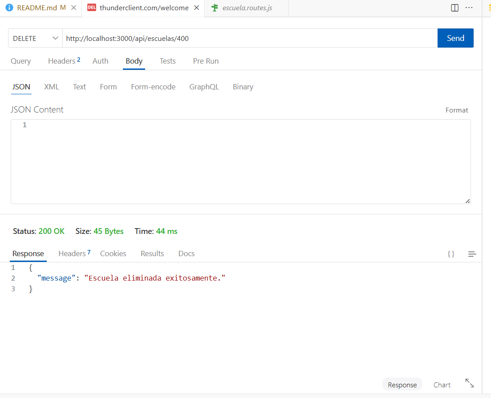

### 8.2.5. Endpoints de PREG

#### 8.2.5.1. Prueba de GET 

##### Resultado Esperado:
#### 8.2.5.2. Prueba de GET con ID

##### Resultado Esperado:
#### 8.2.5.3. Prueba de POST

##### Resultado Esperado:
#### 8.2.5.4. Prueba de PUT

##### Resultado Esperado:
#### 8.2.5.5. Prueba de DELETE

##### Resultado Esperado:


### 8.2.6. Endpoints de PREG_PRACT

#### 8.2.6.1. Prueba de GET 

##### Resultado Esperado:
#### 8.2.6.2. Prueba de GET con ID

##### Resultado Esperado:
#### 8.2.6.3. Prueba de POST

##### Resultado Esperado:
#### 8.2.6.4. Prueba de PUT

##### Resultado Esperado:
#### 8.2.6.5. Prueba de DELETE

##### Resultado Esperado:


### 8.2.7. Endpoints de MUNICIPIO

#### 8.2.7.1. Prueba de GET 

**Endpoint:** /api/municipios

**URL Completa:** http://localhost:3000/api/municipios

##### Resultado Esperado:

**Código de Estado:**
```json
200 OK
```

**Cuerpo de la Respuesta (Body):** Un array JSON con los 5 municipios iniciales.

```json
[
    { "ID_MUNICIPIO": 101, "NOMBRE": "Guatemala", "CODIGO": 1, "DEPARTAMENTO_ID_DEPARTAMENTO": 1 },
    { "ID_MUNICIPIO": 107, "NOMBRE": "Mixco", "CODIGO": 7, "DEPARTAMENTO_ID_DEPARTAMENTO": 1 },
    { "ID_MUNICIPIO": 108, "NOMBRE": "Villa Nueva", "CODIGO": 8, "DEPARTAMENTO_ID_DEPARTAMENTO": 1 },
    { "ID_MUNICIPIO": 301, "NOMBRE": "Antigua Guatemala", "CODIGO": 1, "DEPARTAMENTO_ID_DEPARTAMENTO": 3 },
    { "ID_MUNICIPIO": 501, "NOMBRE": "Escuintla", "CODIGO": 1, "DEPARTAMENTO_ID_DEPARTAMENTO": 2 }
]
```

Efectivamente funcionó correctamente:
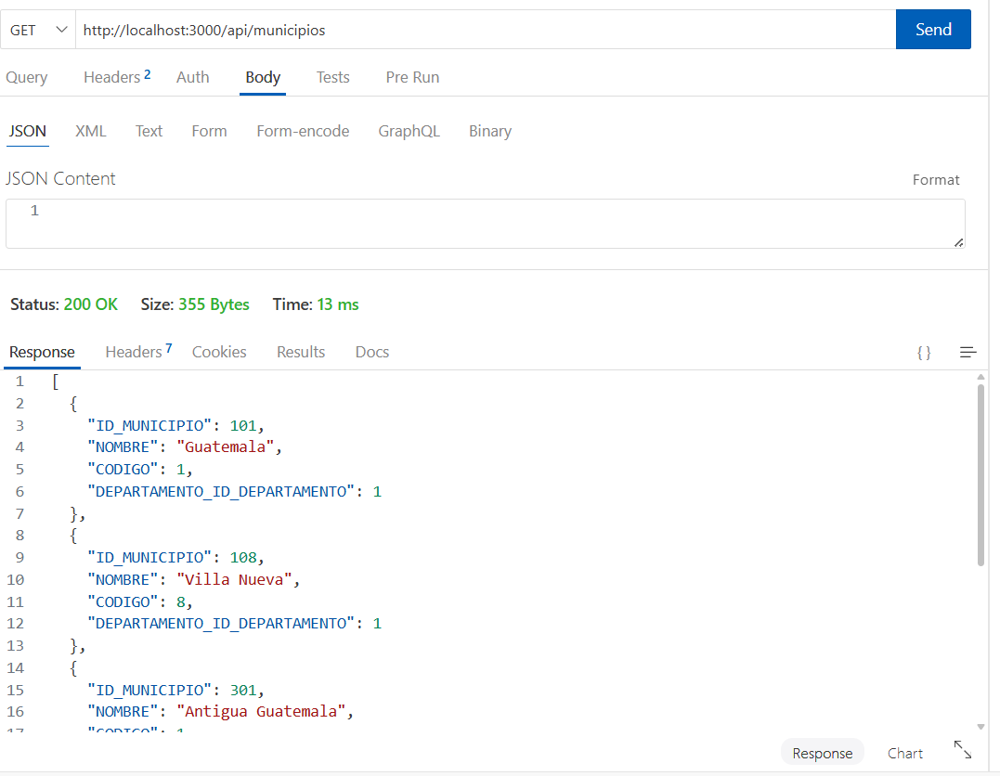

#### 8.2.7.2. Prueba de GET con ID

**Endpoint:** /api/municipios/:id

**URL Completa:** http://localhost:3000/api/municipios/108

##### Resultado Esperado:

**Código de Estado:** 
```json
200 OK
```

**Cuerpo de la Respuesta (Body):** Un único objeto JSON para Villa Nueva.
```json
{
    "ID_MUNICIPIO": 108,
    "NOMBRE": "Villa Nueva",
    "CODIGO": 8,
    "DEPARTAMENTO_ID_DEPARTAMENTO": 1
}
```

Efectivamente funcionó correctamente:


#### 8.2.7.3. Prueba de POST

**Endpoint:** /api/municipios

**Url completo:** http://localhost:3000/api/municipios

**Acción (Body - raw/JSON):**

```json
{
    "id_municipio": 115,
    "nombre": "Amatitlán",
    "codigo": 15,
    "departamento_id_departamento": 1
}
```

##### Resultado Esperado:

**Código de Estado:**

```json
201 Created
```

**Cuerpo de la Respuesta (Body):** Un mensaje de éxito con los datos creados:

```json
{
  "message": "Municipio creado exitosamente",
  "data": {
    "id_municipio": 115,
    "nombre": "Amatitlán",
    "codigo": 15,
    "departamento_id_departamento": 1
  }
}
```

Y efectivamente funcionó correctamente.

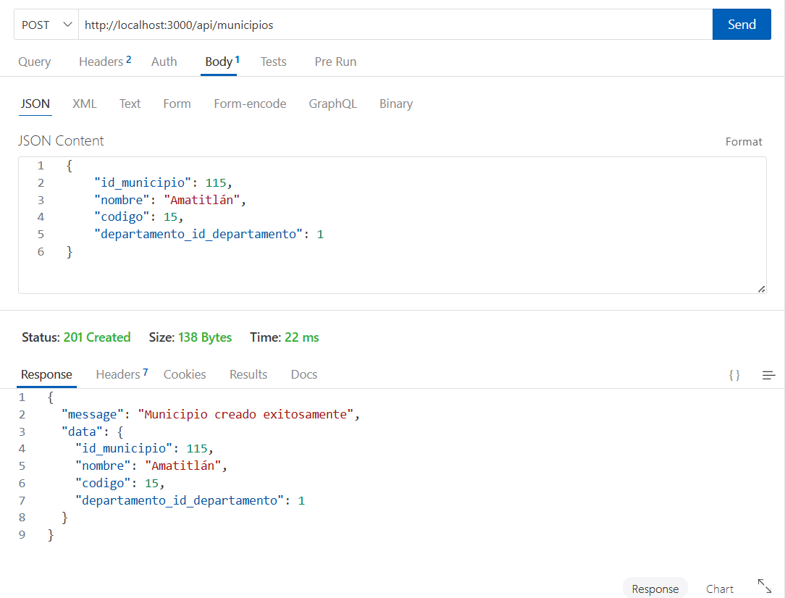

#### 8.2.7.4. Prueba de PUT

**Endpoint:** /api/municipios/:id

**URL Completa:** http://localhost:3000/api/municipios/115

**Acción (Body - raw/JSON):** 

```json
{
    "nombre": "Amatitlán (actualizado)",
    "codigo": 15,
    "departamento_id_departamento": 1
}
```

##### Resultado Esperado:

**Código de Estado:** 
```json
201 OK
```

**Cuerpo de la Respuesta (Body):** Un mensaje de éxito con los datos actualizados.

```json
{
  "message": "Municipio actualizado exitosamente."
}
```

Y efectivamente funcinó:


#### 8.2.7.5. Prueba de DELETE

**Endpoint:** /api/municipios/:id

**URL Completa:** http://localhost:3000/api/municipios/115

##### Resultado Esperado:

##### Resultado Esperado:

**Código de Estado:**
```json
200 OK
```

**Cuerpo de la Respuesta (Body):**

```json
{
    "message": "Municipio eliminado exitosamente."
}
```

Efectivamente funcionó:

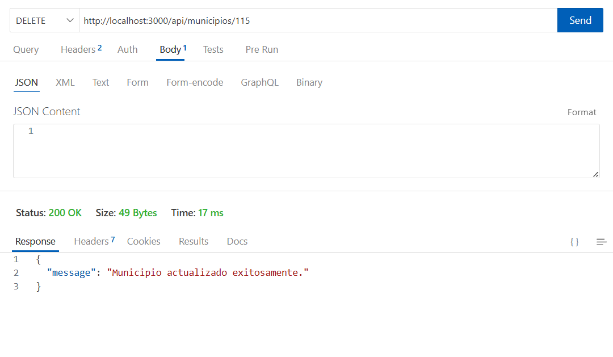

### 8.2.8. Endpoints de UBICACION


#### 8.2.8.1. Prueba de GET 

##### Resultado Esperado:
#### 8.2.8.2. Prueba de GET con ID

##### Resultado Esperado:
#### 8.2.8.3. Prueba de POST

##### Resultado Esperado:
#### 8.2.8.4. Prueba de PUT

##### Resultado Esperado:
#### 8.2.8.5. Prueba de DELETE

##### Resultado Esperado:


### 8.2.9. Endpoints de REGISTRO

#### 8.2.9.1. Prueba de GET 

##### Resultado Esperado:
#### 8.2.9.2. Prueba de GET con ID

##### Resultado Esperado:
#### 8.2.9.3. Prueba de POST

##### Resultado Esperado:
#### 8.2.9.4. Prueba de PUT

##### Resultado Esperado:
#### 8.2.9.5. Prueba de DELETE

##### Resultado Esperado:

### 8.2.10. Endpoints de EXAMEN

#### 8.2.10.1. Prueba de GET 

##### Resultado Esperado:
#### 8.2.10.2. Prueba de GET con ID

##### Resultado Esperado:
#### 8.2.10.3. Prueba de POST

##### Resultado Esperado:
#### 8.2.10.4. Prueba de PUT

##### Resultado Esperado:
#### 8.2.10.5. Prueba de DELETE

##### Resultado Esperado:


### 8.2.11. Endpoints de RES_PRACT_USU

#### 8.2.11.1. Prueba de GET 

##### Resultado Esperado:
#### 8.2.11.2. Prueba de GET con ID

##### Resultado Esperado:
#### 8.2.11.3. Prueba de POST

##### Resultado Esperado:
#### 8.2.11.4. Prueba de PUT

##### Resultado Esperado:
#### 8.2.11.5. Prueba de DELETE

##### Resultado Esperado:

### 8.2.12. Endpoints de RES_USU

#### 8.2.12.1. Prueba de GET 

##### Resultado Esperado:
#### 8.2.12.2. Prueba de GET con ID

##### Resultado Esperado:
#### 8.2.12.3. Prueba de POST

##### Resultado Esperado:
#### 8.2.12.4. Prueba de PUT

##### Resultado Esperado:
#### 8.2.12.5. Prueba de DELETE

##### Resultado Esperado:


## 9. Capturas de evidencias


